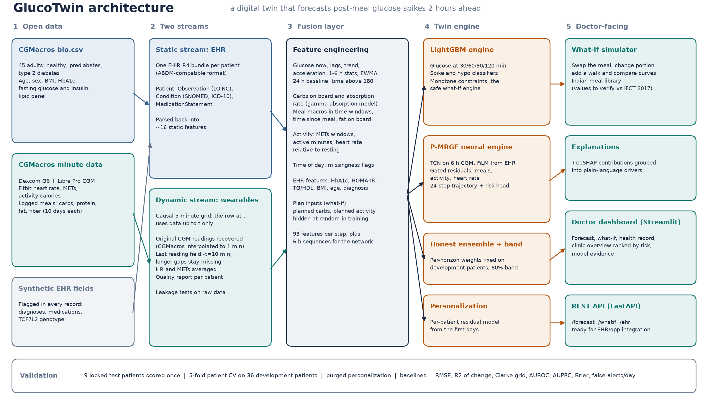

# GlucoTwin: a digital twin that warns of post-meal glucose spikes 2 hours ahead

> Happiest Health Digital Twin Challenge 2026 submission.
> Repository folder name for submission: **`TheGoalDiggers_IIITDMKurnool`**

| | |
|---|---|
| **Team name** | The Goal Diggers |
| **College / incubator** | [Indian Institute of Information Technology, Design and Manufacturing (IIITDM), Kurnool](https://iiitk.ac.in/) |
| **Team members** | Raman Kumar, Aditya Mehrda, Deepak Verma, Sahil Pazare |
| **Chronic condition** | Type 2 diabetes (including its early stage, prediabetes) |
| **Repository** | [github.com/rmnkumrydv-cloud/TheGoalDiggers_IIITDMKurnool](https://github.com/rmnkumrydv-cloud/TheGoalDiggers_IIITDMKurnool) |
| **Live demo** | [glucotwin.streamlit.app](https://glucotwin.streamlit.app) (runs on synthetic demo data, see [Live demo and deployment](#live-demo-and-deployment)) |
| **Demo video (unlisted YouTube)** | [Watch on YouTube](https://www.youtube.com/watch?v=QoWawBauaQU) |
| **Presentation** | [`docs/presentation.pdf`](docs/presentation.pdf) |
| **Architecture diagram** | [`docs/architecture.pdf`](docs/architecture.pdf) |
| **License** | MIT for the code ([LICENSE](LICENSE)); the dataset has its own license (see [Data](#data)) |



## Contents

1. [Problem statement and use case](#problem-statement)
2. [Data](#data)
3. [How GlucoTwin works: AI/ML model and framework details](#how-glucotwin-works-aiml-model-and-framework-details)
4. [Results](#results)
5. **[Setup and run, step by step](#setup-and-run-step-by-step)** (virtual environment, data download, train, test)
6. [Live demo and deployment](#live-demo-and-deployment) (<https://glucotwin.streamlit.app>)
7. [Folder structure](#folder-structure)
8. [How the pipeline prevents data leakage](#how-the-pipeline-prevents-data-leakage)
9. [Configuration, experiments and ablations](#configuration-experiments-and-ablations)
10. [Run times](#run-times)
11. [Troubleshooting](#troubleshooting)
12. [Open-source license](#open-source-license)
13. [Limitations, disclaimer and citations](#limitations)

---

## Problem statement

India has an estimated 101 million people living with diabetes and another 136 million with
prediabetes (ICMR-INDIAB, *Lancet Diabetes & Endocrinology*, 2023). Indian diets are
carbohydrate-heavy, and the same meal can raise glucose very differently in two people. Repeated
post-meal spikes are linked to poorer long-term control, but doctors see HbA1c only every few
months and cannot tell a patient in advance which meals will spike *their* glucose.

**GlucoTwin** is a virtual replica of one patient's glucose metabolism. It fuses a static health
record (demographics, HbA1c, fasting labs, diagnoses) with dynamic wearable data (continuous
glucose monitor, heart rate, activity, logged meals) and:

1. **Forecasts glucose 30, 60, 90 and 120 minutes ahead**, with an uncertainty band.
2. **Predicts the adverse event before it happens**: a post-meal excursion (glucose reaching
   180 mg/dL, or rising 50 mg/dL above the current level) within the next 2 hours.
3. **Answers "what if"**: a smaller rice portion, millets instead of rice, a 15-minute walk after
   lunch, showing the predicted effect before the doctor gives the advice.
4. **Explains itself** in plain language (which factors push the forecast up or down).
5. **Personalizes** after a short calibration period (the patient's first 3 days).

### Healthcare use case

A diabetologist opens the dashboard during a follow-up. The clinic overview ranks patients by
current spike risk. For one patient, the twin shows that lunch typically drives glucose above
180 mg/dL within an hour, that the main drivers are carbohydrate load and low activity after
meals, and that a simulated alternative (half the rice plus a brisk 15-minute walk) keeps the peak
lower. The doctor gives specific, personalized advice instead of generic diet rules.

## Data

Open and de-identified data only, as the challenge requires.

| Stream | Source | Content |
|---|---|---|
| Static (EHR) | CGMacros `bio.csv` | Age, sex, BMI, HbA1c, fasting glucose, fasting insulin, lipid panel |
| Static (EHR, synthetic) | generated, flagged in every record | Past diagnoses, medications, TCF7L2 rs7903146 genotype (the dataset has none) |
| Dynamic (wearable) | CGMacros participant files | Dexcom G6 and Libre Pro CGM, Fitbit heart rate and METs, logged meal macronutrients |

**CGMacros** (PhysioNet, open access): 45 adults (15 healthy, 16 prediabetes, 14 type 2
diabetes), about 10 days each, free living. The license is **CC BY-NC-SA 4.0**, so the data is
**not** in this repository: `scripts/download_data.py` fetches it (step 5 below). Synthetic EHR
fields carry a `synthetic` FHIR extension and are **not** used as model features, because random
values carry no real signal. Details and the data-quality checklist: [docs/DATA.md](docs/DATA.md).

> **Important preprocessing detail.** CGMacros stores CGM values at 1-minute rows that were
> linearly interpolated between the real readings (every 5 min for Dexcom, 15 min for Libre), so an
> interpolated value partly contains the *next* reading. GlucoTwin recovers the original readings
> and builds a strictly causal 5-minute grid. A test proves that changing raw data after time T
> cannot change any model input at or before T.

## How GlucoTwin works: AI/ML model and framework details

1. **Two streams** (`data.py`, `ehr.py`). Wearable data becomes a causal 5-minute grid. The EHR is
   written as one FHIR R4-style bundle per patient (Patient, Observation with LOINC codes,
   Condition with SNOMED and ICD-10 codes, MedicationStatement), the format used by India's
   Ayushman Bharat Digital Mission. The model reads its static features back **from the FHIR record**.
2. **Fusion layer** (`features.py`). 93 features per time step: glucose history, trend,
   variability and 6-hour context; carbohydrates on board from a gamma absorption model; meal
   macros by time window; activity and heart rate relative to rest; time of day; missing-data
   indicators; EHR features (HbA1c, HOMA-IR, TG/HDL, BMI, age, diagnosis); and *plan inputs*
   (planned carbs, planned activity) used only by the what-if simulator.
3. **Twin engines.**
   - **LightGBM** (`models.py`): one regressor per horizon for the glucose change, quantile models
     plus conformal calibration for an 80% band, and classifiers for spikes and hypoglycaemia.
     Monotone constraints guarantee that more carbohydrate never lowers, and more planned activity
     never raises, a forecast or a risk. It powers the what-if simulator.
   - **P-MRGF** (`nn.py`, optional, PyTorch): a causal dilated TCN over 6 hours of CGM, conditioned
     on the health record with FiLM, plus zero-initialised gated residual corrections from meals,
     activity and heart rate. It predicts the full 24-step trajectory, quantiles and spike risk.
   - **Ensemble** (`ensemble.py`): per-horizon blend with weights chosen on development patients.
4. **Personalization.** A small per-patient residual model is fitted on the first 3 days and
   used only afterwards.
5. **Services.** FastAPI endpoints (`app/api.py`) and a Streamlit doctor dashboard
   (`app/dashboard.py`) with forecast, what-if, health record, clinic overview and model evidence.

### Technical stack

Python, pandas, NumPy, LightGBM, PyTorch (optional, CPU is enough), scikit-learn,
Optuna, Matplotlib, Plotly, FastAPI, Streamlit, pytest, Docker (optional). No GPU needed.

## Results

Headline numbers come from **9 locked test patients** (002, 004, 013, 014, 020, 032, 042, 044,
049; 3 per metabolic group) that were set aside before any training or tuning. Every model,
threshold and ensemble weight was chosen on the 36 development patients only, and the test was run
once. Brackets are 95% confidence intervals from resampling patients; with only 9 test patients
they are wide, so quote them. Full tables, Clarke grids and figures: `artifacts/test/RESULTS_TEST.md`.
Never report numbers from the synthetic demo data.

| Model (locked test patients, RMSE in mg/dL, lower is better) | 30 min | 60 min | 90 min | 120 min |
|---|---|---|---|---|
| Persistence (no change) | 20.9 | 30.5 | 36.3 | 40.3 |
| Ridge regression | 17.4 | 24.3 | 27.4 | 28.8 |
| **GlucoTwin (LightGBM)**, future meals and activity unknown | **16.9** (14.9 to 18.6) | **23.1** (20.2 to 26.0) | **25.7** (21.5 to 29.9) | **27.4** (22.5 to 32.2) |
| GlucoTwin personalized (scored after the calibration days) | 16.5 | 22.8 | 25.2 | 26.6 |
| P-MRGF (neural network alone) | 18.0 | 25.5 | 28.8 | 30.1 |
| Ensemble (LightGBM + P-MRGF) | 16.9 | 23.0 | 25.8 | 27.4 |

GlucoTwin lowers the error of the "no change" baseline by about 19% at 30 minutes and 32% at 120
minutes, and is slightly better than ridge regression (a gap smaller than the confidence
intervals). Personalization is scored on the days after calibration, so compare it with the
population model on the same rows (16.9, 23.1, 25.5 and 27.0 mg/dL): it gains 0.3 to 0.4 mg/dL.
**The ensemble does not beat LightGBM** on the test patients (equal at 30 and 120 minutes, 0.1
better at 60 and 0.1 worse at 90, spike AUROC 0.848 against 0.850), so LightGBM is the headline
model and the neural network is reported for completeness. By metabolic group, 120-minute RMSE is
19.9 (healthy), 25.5 (prediabetes) and 34.7 (type 2 diabetes): the twin is least accurate where
it matters most.

**Spike prediction on the test patients** (excursion above 180 mg/dL or a rise of 50 mg/dL within
2 hours; 22,262 rows, 15.8% positive): AUROC 0.850 (95% CI 0.803 to 0.894), AUPRC 0.550, Brier
score 0.128. At the threshold chosen on development patients: precision 0.45, recall 0.67,
specificity 0.84. At event level, 96% of the 160 crossings above 180 mg/dL were caught in advance
(median warning 120 min, the longest measurable), with 2.66 false alerts per patient-day and the
alert active 32% of the time. Clarke error grid zone A+B at 60 min: 99.4% (zone A 81.7%); the 80%
uncertainty band covers 78.5 to 79.8% of outcomes.

### Development results (cross-validation)

Leave-patients-out cross-validation over the 36 development patients: every patient is scored by a
model that never saw them. These numbers were used to choose settings; the test patients above were
not. Full tables: `artifacts/cv/RESULTS_CV.md` and `artifacts/cv/RESULTS_ENSEMBLE_CV.md` (generated
by `python -m glucotwin.train` on the real data).

| Model (development patients, RMSE in mg/dL, lower is better) | 30 min | 60 min | 90 min | 120 min | Spike AUROC |
|---|---|---|---|---|---|
| **GlucoTwin (LightGBM)** | **17.4** | **24.4** | **28.0** | **30.1** | **0.799** |
| P-MRGF (neural network alone) | 18.1 | 26.0 | 30.9 | 33.5 | 0.785 |
| Ensemble (LightGBM + P-MRGF) | 17.3 | 24.3 | 27.9 | 29.9 | 0.815 |

In cross-validation the ensemble lowers the error by only 0.1 to 0.2 mg/dL; on the locked test
patients it did not improve on LightGBM at all, so LightGBM is the deployed model.

**What each data stream adds** (same cross-validation):

| Inputs (RMSE in mg/dL) | 30 min | 60 min | 90 min | 120 min | Spike AUROC |
|---|---|---|---|---|---|
| CGM only | 18.3 | 25.7 | 29.4 | 31.2 | 0.774 |
| + health record | 18.3 | 25.6 | 29.2 | 31.0 | 0.770 |
| + meals | 17.4 | 24.5 | 28.1 | 30.1 | 0.802 |
| + activity | 17.5 | 24.6 | 28.1 | 30.1 | 0.800 |
| **GlucoTwin, all inputs** | **17.4** | **24.4** | **28.0** | **30.1** | **0.799** |
| All but health record | 17.2 | 24.4 | 28.2 | 30.3 | 0.793 |

Meals give the largest gain (about 1 mg/dL at every horizon), the health record helps a little at
90 to 120 minutes, and wrist activity and heart rate carry little signal in this mostly sedentary
cohort. Differences of 0.1 to 0.2 mg/dL are within noise; the full model was kept, as decided
before the test.

**Spike alert at the development threshold, cross-validation versus locked test:** sensitivity /
specificity 0.37 / 0.94 versus 0.67 / 0.84, precision 0.52 versus 0.45, crossings warned in advance
67% versus 96%, false alerts per patient-day 1.62 versus 2.66, share of time an alert shows 19%
versus 32%. The ranking of risk is stable (test AUROC 0.85), but the threshold, set on a few
development patients, alerted more often on the test patients.

We do not headline R² on absolute glucose or classification accuracy: glucose changes so slowly
that "no change" already scores a high R², and a spike model that never alerts scores high
accuracy. The results files report R² of the predicted *change*, AUPRC, Brier score and false
alerts per day instead.

---

## Setup and run, step by step

Everything runs on a normal laptop CPU. Commands are given for **Windows (PowerShell)** and
**macOS / Linux (Terminal)**; where only one line is shown, it is the same on all systems.

**Quick version** (after creating and activating the virtual environment in step 2):

```bash
pip install -r requirements.txt && pip install -e .     # step 3
python -m pytest -q                                     # step 4: about 2-4 min, everything should pass
python scripts/download_data.py --from-zip <zip>        # step 5: after downloading the zip in a browser
python -m glucotwin.prepare                             # step 6: streams, EHR, locked split, quality report
python -m glucotwin.train                               # step 8: development patients only
python -m glucotwin.test                                # step 10: locked test patients, run ONCE at the end
streamlit run app/dashboard.py                          # step 11
```

### Step 0. Prerequisites

- **Python 3.11 or 3.12** (3.10 and 3.13 also tested; 3.14 is untested, so if installing or the
  tests fail on 3.14, use 3.12). Check with `python --version`
  (on macOS/Linux it may be `python3 --version`). Install from https://www.python.org/downloads/;
  on Windows, tick **"Add python.exe to PATH"** in the installer.
- **Git** (optional, to clone): https://git-scm.com/downloads
- About **4 GB RAM** and **3 GB free disk** (plus about 1 GB if you install PyTorch).
- **macOS only:** LightGBM needs OpenMP: `brew install libomp` (install Homebrew from https://brew.sh first).

### Step 1. Get the code

```bash
git clone https://github.com/rmnkumrydv-cloud/TheGoalDiggers_IIITDMKurnool.git TheGoalDiggers_IIITDMKurnool
cd TheGoalDiggers_IIITDMKurnool
```

Or unzip `GlucoTwin.zip`, rename the folder to `TheGoalDiggers_IIITDMKurnool` (the challenge requires this
name) and open a terminal inside it. **Every command below is run from this folder.**

### Step 2. Create and activate a virtual environment

A virtual environment keeps this project's packages separate from the rest of your computer.
Create it once; activate it every time you open a new terminal.

**Windows (PowerShell):**

```powershell
python -m venv .venv
.venv\Scripts\Activate.ps1
```

If PowerShell says *running scripts is disabled*, run this once and try again:
`Set-ExecutionPolicy -Scope CurrentUser -ExecutionPolicy RemoteSigned`.
In the older Command Prompt (cmd), activate with `.venv\Scripts\activate.bat` instead.

**macOS / Linux:**

```bash
python3 -m venv .venv
source .venv/bin/activate
```

When it is active, your prompt starts with `(.venv)`. From now on, `python` means the
environment's Python on every system. To leave it: `deactivate`.

### Step 3. Install the packages

```bash
python -m pip install --upgrade pip
pip install -r requirements.txt
pip install -e .
```

**Note the full stop at the end of `pip install -e .`** (it means "this folder"); without it pip
says `-e option requires 1 argument`. If the dot keeps getting lost, give the folder explicitly,
for example `pip install -e "C:\Users\<you>\Downloads\TheGoalDiggers_IIITDMKurnool"`. This makes the
`glucotwin` package importable (no `PYTHONPATH` needed); it should end with
`Successfully installed glucotwin-0.2.0`.

Optional, for the neural engine (P-MRGF):

```bash
pip install -r requirements-nn.txt                                      # Windows and macOS
pip install torch --index-url https://download.pytorch.org/whl/cpu      # Linux (avoids a 5 GB GPU build)
```

### Step 4. Check that everything works (no data needed)

```bash
python -m pytest -q
```

This builds a tiny synthetic cohort and runs the **whole** pipeline on it, plus the data-leakage
tests (about 2 to 4 minutes). Expect `19 passed` (or `18 passed, 1 skipped` without PyTorch). If something fails, see
[Troubleshooting](#troubleshooting) before continuing.

### Step 5. Download the data

The dataset is one zip of about 630 to 660 MB (most of it is meal photos, which the model does not
use). **The most reliable way is to download it in your browser**, then let the script unzip it.

**a) Download the zip from any one of these links** (same data; if one is slow, try the next):

| Source | Link |
|---|---|
| PhysioNet (official) | https://physionet.org/files/cgmacros/1.0.0/CGMacros_dateshifted365.zip |
| PhysioNet's AWS mirror | https://physionet-open.s3.amazonaws.com/cgmacros/1.0.0/CGMacros_dateshifted365.zip |
| figshare (Scientific Data journal copy) | https://ndownloader.figshare.com/files/56754167 (landing page: https://doi.org/10.6084/m9.figshare.29733005) |

The PhysioNet dataset page is https://physionet.org/content/cgmacros/1.0.0/. If a download stalls,
pause and resume it from the browser's Downloads page (`Ctrl + J`), or switch to a phone hotspot.

**b) Unzip it into the project** (works for every link above, including the figshare and
"Download the ZIP file" bundles that contain the data zip inside another zip):

```bash
python scripts/download_data.py --from-zip "C:\Users\<you>\Downloads\CGMacros_dateshifted365.zip"   # Windows
python scripts/download_data.py --from-zip ~/Downloads/CGMacros_dateshifted365.zip                      # macOS / Linux
```

Use the real path and file name of your download (the figshare file has a longer name). On
Windows, right-click the zip in File Explorer, choose **Copy as path**, and paste it after
`--from-zip`. Expected ending: `Found 45 participant files and 1 bio.csv`. You can then delete the zip.

Downloading in the terminal also works on a good connection (resumes if interrupted):
`python scripts/download_data.py` (PhysioNet), `--source aws` or `--source figshare`.

Do not commit `data/` to GitHub; the dataset license does not allow redistribution under our MIT
license (`.gitignore` already excludes it).

### Step 6. Prepare the data

```bash
python -m glucotwin.prepare
```

This builds, in `data/processed/`:

- `wearable_stream.parquet`: the causal 5-minute grid of CGM, heart rate, METs and meals;
- `dataset.parquet`: 93 features plus targets per time step;
- `splits.json`: the **locked patient split** (about 20% of patients per metabolic group become
  test patients; the rest are split into 5 cross-validation folds). It is deterministic (fixed seed),
  so every team member gets the same split;
- `DATA_QUALITY.md`: the data-quality report, also printed on screen.

and one FHIR JSON record per patient in `data/ehr/`.

Then check that meal times line up with the glucose rises they cause (a 1-minute check that also
makes a good slide, `artifacts/meal_alignment.png`):

```bash
python scripts/check_meal_alignment.py
```

**Read the quality report before going further** ("Gate 0"). On the real data it should say 45
participants and groups healthy 15, prediabetes 16, t2d 14. A `WARN` line tells you what to check;
[docs/DATA.md](docs/DATA.md) explains each one.

### Step 7. Tune hyperparameters (optional, 20 to 45 minutes)

```bash
python -m glucotwin.tune
```

Optuna searches LightGBM settings using **development patients only** and writes
`artifacts/best_params.yaml`, which the next step uses automatically. Skip it for a first run.

### Step 8. Train (development patients)

```bash
python -m glucotwin.train
```

1. Leave-patients-out cross-validation over the 36 development patients: each one is scored by a
   model that never saw them. Baselines (persistence, linear trend, ridge) are scored on the same rows.
2. Personalization is tested on each held-out patient (calibrated on their first 3 days, scored on
   the rest, with a purge gap in between).
3. A development model is trained on all 36 development patients for the final test.

Results: `artifacts/cv/RESULTS_CV.md` (tables and figures). Use these numbers to compare ideas and
choose settings. Each run also adds a line to `artifacts/experiments.csv`, your team's results log.
`python -m glucotwin.train --quick` is a 1 to 2 minute smoke test.

### Step 9. Neural engine and ensemble (optional, needs PyTorch)

```bash
python -m glucotwin.nn          # P-MRGF: same folds, development patients only (35 to 60 min on CPU)
python -m glucotwin.ensemble    # blend weights chosen on development patients
```

Compare in `artifacts/cv/RESULTS_ENSEMBLE_CV.md`. Keep the ensemble only if it beats LightGBM at
two or more horizons or raises spike AUPRC; otherwise report that honestly.

### Step 10. Test (locked test patients, once, at the end)

```bash
python -m glucotwin.test
```

Scores the 9 locked test patients with everything chosen in steps 7 to 9 (models, alert
thresholds, ensemble weights) and writes `artifacts/test/RESULTS_TEST.md` with 95% confidence
intervals from resampling patients. **These are the numbers for the README, slides and video.**

Run it when every decision is final. Each run is logged in `artifacts/test_runs.csv`; if you
change the model after seeing test results, the test is no longer an unbiased estimate, and you
should say so.

### Step 11. Dashboard and API

```bash
streamlit run app/dashboard.py          # opens http://localhost:8501
uvicorn app.api:app --reload            # API docs at http://127.0.0.1:8000/docs
```

The dashboard replays the monitoring period: pick a patient, a day and a time, then press
**Next CGM reading** to watch the twin update. Every forecast comes from a model that never saw
that patient (fold models for development patients, the development model for test patients).

A hosted copy is available at **<https://glucotwin.streamlit.app>** (see
[Live demo and deployment](#live-demo-and-deployment)).

### Demo without the real data

```bash
python scripts/make_synthetic_data.py --out data/raw/synthetic
python -m glucotwin.prepare --raw data/raw/synthetic
python -m glucotwin.train --quick
python -m glucotwin.test
streamlit run app/dashboard.py
```

Synthetic files have the exact CGMacros format but **are not real**; never report their results.
When you switch to the real data, run `prepare` and `train` again (the test step refuses models
trained on different data).

### macOS / Linux shortcuts

`make install`, `make data`, `make prepare`, `make train`, `make test`, `make dashboard` and so on
run the same commands; each target in the `Makefile` shows the command it runs.

## Live demo and deployment

**Live app: <https://glucotwin.streamlit.app>**

The hosted dashboard runs on **synthetic demo data** (generated by
`scripts/make_synthetic_data.py`). The patients, their health records and their glucose traces
are not real, and the forecasts it shows are **not scientific results**; never quote numbers from
it. The real CGMacros data (CC BY-NC-SA 4.0) and any model trained on it are never published.

The app is hosted on [Streamlit Community Cloud](https://streamlit.io/cloud):

| Setting | Value |
|---|---|
| Main file | `app/dashboard.py` |
| Branch | `deploy` (`main` keeps `data/` and `artifacts/` out of git, see `.gitignore`) |
| Packages | `requirements.txt` (pinned versions, ends with `-e .` so `glucotwin` is importable) |
| Python | the same version the models were trained with (chosen under *Advanced settings* when the app is created) |

Streamlit Cloud only has what is in the repository, so the `deploy` branch carries a small
bundle that `main` does not: the synthetic outputs of steps 6 and 8. To refresh it:

```bash
python scripts/make_synthetic_data.py --out data/raw/synthetic
python -m glucotwin.prepare --raw data/raw/synthetic
python -m glucotwin.train
git checkout deploy
git add -f data/processed/*.parquet data/processed/splits.json data/ehr
git add -f artifacts/models artifacts/run_info.json artifacts/pid_fold.json artifacts/cv artifacts/test
git commit -m "Refresh synthetic demo bundle" && git push
```

Always commit the data and the models together: `TwinService` refuses models whose fingerprint
does not match `data/processed/splits.json`. Models saved on Windows also load on the Linux
host (`GlucoTwinModel.load` maps `WindowsPath` to `PosixPath`).

If the page shows `Failed to fetch dynamically imported module`, the browser holds an outdated
copy of the page or blocks Streamlit's script files: hard refresh (Ctrl+Shift+R), or switch off
the browser's shield or ad blocker for the site.

## Folder structure

```
TheGoalDiggers_IIITDMKurnool/
├── README.md                    this file
├── LICENSE                      MIT (code only)
├── pyproject.toml               makes `pip install -e .` work
├── requirements.txt             core packages
├── requirements-nn.txt          optional PyTorch for the neural engine
├── Makefile, Dockerfile, docker-compose.yml
├── configs/
│   └── config.yaml              every setting: horizons, thresholds, split, model parameters
├── scripts/
│   ├── download_data.py         step 5: download / unzip CGMacros (Windows, macOS, Linux)
│   ├── make_synthetic_data.py   demo data in the CGMacros format
│   ├── check_meal_alignment.py  do logged meal times match the glucose rises?
│   ├── run_experiments.py       compare several settings in one command
│   └── run_ablations.py         what each data stream adds
├── src/glucotwin/
│   ├── data.py                  load CGMacros, recover original CGM readings, causal 5-min grid
│   ├── ehr.py                   FHIR R4-style records and static features
│   ├── features.py              93 causal features and the prediction targets
│   ├── splits.py                locked test patients, stratified folds, purged calibration
│   ├── quality.py               data-quality report
│   ├── prepare.py               step 6
│   ├── tune.py                  step 7
│   ├── models.py                LightGBM twin, baselines, personalization
│   ├── train.py                 step 8
│   ├── nn.py                    step 9: P-MRGF neural engine
│   ├── ensemble.py              step 9: honest blend
│   ├── test.py                  step 10: locked test
│   ├── evaluate.py              metrics, Clarke grid, bootstrap intervals, figures
│   ├── meals.py                 Indian meal library for the what-if simulator
│   └── service.py               the twin used by the API and dashboard
├── app/
│   ├── api.py                   FastAPI
│   └── dashboard.py             Streamlit doctor dashboard
├── tests/
│   ├── test_leakage.py          one test per way a model can leak the future or the test set
│   └── test_pipeline.py         end-to-end run, what-if physiology, API, dashboard
├── docs/                        architecture diagram, data notes, cross-check, timeline,
│                                presentation outline, video script
├── data/                        NOT committed (dataset license)
│   ├── raw/cgmacros/            step 5: CGMacros-001/CGMacros-001.csv ... and bio.csv
│   ├── processed/               step 6: parquet files, splits.json, DATA_QUALITY.md
│   └── ehr/                     step 6: patient_001.json ... (FHIR bundles)
└── artifacts/                   created by steps 7-10
    ├── models/                  fold_0..4.joblib, model_dev.joblib, nn_*.pt   (not committed)
    ├── cv/                      RESULTS_CV.md, metrics_cv.json, figures/      (commit these)
    ├── test/                    RESULTS_TEST.md, metrics_test.json, figures/  (commit these)
    ├── best_params.yaml, ensemble_weights.json, experiments.csv, test_runs.csv
    └── ablations/ABLATIONS.md
```

## How the pipeline prevents data leakage

A glucose model can look far better than it is in several ways. Each one is blocked in code and
checked by a test in `tests/test_leakage.py`.

| Way to leak | What GlucoTwin does | Test |
|---|---|---|
| CGMacros' 1-minute CGM values are interpolated, so they contain the next reading | Only the original readings are kept; the 5-minute grid is right-labelled (the 12:00 row uses data up to 12:00); gaps are bridged only by carrying the last reading forward for at most 10 min | `test_raw_minute_data_after_t_cannot_change_the_stream_before_t`, `test_original_cgm_readings_are_recovered...` |
| A feature accidentally uses future values | Every feature is a backward-looking window; meals count from the first grid time after they were logged | `test_features_never_use_the_future` |
| Targets or IDs used as features | Targets, labels, patient id and time are excluded by name | `test_targets_and_identifiers_are_never_features` |
| Future meals/activity used in the forecast | The what-if "plan" inputs are hidden in every reported forecast and in the alerts | `test_honest_mode_hides_every_future_plan_input` |
| The same person in training and testing (near-identical windows on both sides) | All splits are by **patient**, never by row or window | `test_split_is_patient_level_stratified_and_deterministic` |
| Choosing settings on the numbers you report | A **locked test set** (20% of patients, stratified) is excluded from tuning, cross-validation, the neural model, thresholds and ensemble weights; only `glucotwin.test` reads it | `test_no_model_ever_trained_on_a_locked_test_patient` |
| Early stopping or tuning on the scored patients | Early stopping uses separate validation patients from the training side, in training and in tuning | code: `models.py`, `tune.py` |
| Personalization calibrated on rows whose targets fall in the evaluation days | Calibration ends one full horizon (purge gap) before the evaluation days; a model may only be calibrated on patients it never trained on | `test_personalization_calibration_is_purged`, `test_a_model_cannot_be_calibrated_on_a_patient_it_was_trained_on` |
| Personalized forecasts shown on the calibration days themselves | The dashboard applies personalization only after the patient's calibration cutoff | `test_personalization_is_never_applied_to_the_calibration_days` |
| Demo forecasts from a model that saw the patient | The service picks, for each patient, a model that never trained on them | `test_dashboard_serves_every_patient_with_a_model_that_never_saw_them` |
| Normalisation fitted on all data | Scalers (ridge baseline, neural model) are fitted on training rows only | code: `models.py`, `nn.py` |
| Testing models trained on different data | `prepare` writes a data fingerprint; `test` refuses models trained on another dataset or split | `test_test_refuses_models_trained_on_other_data` |
| Peeking at the test set repeatedly | Every test run is logged in `artifacts/test_runs.csv` with a warning after the first | `glucotwin.test` |

Patient flow:

```
45 patients ──► stratified by group ──► 9 LOCKED TEST patients ─────────────────────► glucotwin.test (once)
                                    └─► 36 DEVELOPMENT patients
                                          ├─ 5-fold CV (by patient) ──► RESULTS_CV.md, choose settings
                                          ├─ tuning, thresholds, ensemble weights
                                          └─ development model (all 36) ───────────► scored on the 9 test patients
Inside each scored patient:  [ first 3 days: calibration ] [ purge gap ] [ later days: scored ]
```

## Configuration, experiments and ablations

All settings live in `configs/config.yaml`; change them there, not in code. The most useful ones:

| Setting | Default | Try |
|---|---|---|
| `data.primary_cgm` | `auto` | `dexcom`, `libre` |
| `task.spike_definition`, `spike_rise_mgdl` | `either`, 50 | `absolute`; 40 |
| `features.carb_absorption_tau_min` | 45 | 30, 60 |
| `features.plan_dropout` | 0.5 | 0.3, 0.7 |
| `model.zone_weights` | off | `{180: 1.5, 250: 2.0}` |
| `model.classifier_threshold` | `spec90` (at most 10% of non-spike times alert) | `spec85`, `spec95`, `breakeven`, `f1` |
| `model.hypo_alerts` | `false` (too few lows in CGMacros to be reliable) | `true` |
| `personalization.method` | `residual` | `gain` (the patient's own sensitivity), `bias` |
| `personalization.calibration_days` | 3 | 1, 2, 4 |
| `nn.context_min` | 360 | 180, 720 |

Change one thing at a time, run `python -m glucotwin.train --tag "what you changed"`, and compare
rows in `artifacts/experiments.csv` (cross-validation numbers only). Besides error, it records the
alert burden (`cv_alert_on_time_pct`, `cv_false_alerts_per_day`, `cv_spike_events_caught_pct`)
and the personalization gain per horizon (`cv_pers_gain_*`, positive means personalization helped).
Changing anything in the `task` section (for example `spike_definition`) changes the labels, so
run `python -m glucotwin.prepare` again before training (the patient split stays the same). Do not touch the `split`
section once the team has started: it defines the locked test patients.

**Compare several settings in one command** (personalization methods, spike definition; edit the
list at the top of the script to try others):

```bash
python scripts/run_experiments.py       # about 4 training runs; table in artifacts/experiments/EXPERIMENTS.md
```

**Ablations** (what each data stream adds, for the jury):

```bash
python scripts/run_ablations.py         # about 1 to 1.5 hours; table in artifacts/ablations/ABLATIONS.md
```

## Run times

Measured on a 2-core cloud machine (8 GB RAM) with a synthetic cohort the same size as CGMacros
(45 patients x 10 days, about 128,000 rows). A typical 4 to 8 core laptop is faster.

| Step | Command | Time |
|---|---|---|
| Install packages | `pip install -r requirements.txt` | 2 to 5 min |
| Tests | `python -m pytest -q` | about 2 min |
| Download | `python scripts/download_data.py` | 5 to 20 min (network) |
| Prepare | `python -m glucotwin.prepare` | under 1 min |
| Tune (optional) | `python -m glucotwin.tune` | up to 45 min (set in config) |
| Train | `python -m glucotwin.train` | about 13 min (5 folds x 2 min + development model 2 min) |
| Neural engine (optional) | `python -m glucotwin.nn` | about 35 min with `--epochs 8`; up to about 60 min with the default 15 epochs |
| Ensemble | `python -m glucotwin.ensemble` | seconds |
| Test | `python -m glucotwin.test` | under 1 min |
| Ablations | `python scripts/run_ablations.py` | 5 x train time |

## Troubleshooting

| Problem | Fix |
|---|---|
| `python` not found (Windows) | Reinstall Python with "Add python.exe to PATH" ticked, or use `py` instead of `python` |
| `running scripts is disabled on this system` (PowerShell) | `Set-ExecutionPolicy -Scope CurrentUser -ExecutionPolicy RemoteSigned`, then activate again |
| `ModuleNotFoundError: No module named 'glucotwin'` | The prompt must start with `(.venv)` (activate it, step 2); then run `pip install -e .` from the project folder, **with the final dot** |
| `-e option requires 1 argument` | The dot is missing: `pip install -e .` |
| The error path shows `AppData\Local\Python\...python.exe` instead of `.venv\Scripts\python.exe` | The virtual environment is not active: `.venv\Scripts\Activate.ps1` (or select the `.venv` interpreter in VS Code) |
| LightGBM error mentioning `libomp` (macOS) | `brew install libomp`, then reinstall: `pip install --force-reinstall lightgbm` |
| `CERTIFICATE_VERIFY_FAILED` during download (macOS) | Run "Install Certificates.command" in your Python folder in Applications, or use `--from-zip` |
| Download blocked, very slow or stuck at 0.0 MB/s | Download the zip in a browser from one of the three links in step 5 and use `--from-zip`; try a phone hotspot |
| `Something is missing (expected 45 participant files...)` | The zip is incomplete (re-download it), or you pointed `--from-zip` at a different file |
| `is incomplete or corrupt` | The browser download did not finish: resume or re-download it |
| `splits.json not found` | Run `python -m glucotwin.prepare` first |
| `trained on a different dataset or split` | You re-prepared the data (or switched synthetic/real): run `python -m glucotwin.train` again |
| `No CGMacros-XXX.csv files under data/raw/cgmacros` | Step 5 did not finish; or for demo data add `--raw data/raw/synthetic` |
| Quality report: groups are not 15/16/14 | Check the `bio.csv` subject column and HbA1c units ([docs/DATA.md](docs/DATA.md)) |
| `MemoryError` or very slow neural training | Close other programs; `python -m glucotwin.nn --threads 4`; or skip the neural engine |
| Dashboard says "has not been trained yet" | Run steps 6, 8 and 10 first, then reload the page. On Streamlit Cloud the data and models must be committed to the deployed branch ([Live demo and deployment](#live-demo-and-deployment)) |
| `cannot instantiate 'WindowsPath' on your system` (Linux / Streamlit Cloud) | The models were saved on Windows. Use the current `src/glucotwin/models.py` (its `load` maps the path type) |
| `Failed to fetch dynamically imported module` in the browser | Hard refresh (Ctrl+Shift+R) or disable the browser shield / ad blocker for the site; pin `streamlit` in `requirements.txt` |
| Port 8501 or 8000 already in use | `streamlit run app/dashboard.py --server.port 8502` or `uvicorn app.api:app --port 8001` |
| Torch download is huge on Linux | Use the CPU index URL in step 3 |

## Open-source license

The **code** is released under the **MIT License** (see [LICENSE](LICENSE)): you may use, copy,
modify and distribute it, keeping the copyright notice. The **CGMacros dataset** is *not* covered
by it: it has its own license, **CC BY-NC-SA 4.0** (non-commercial, share-alike), which is why the
data is downloaded by `scripts/download_data.py` and never committed to this repository.

## Limitations

- 45 participants in the USA, 10 days each; breakfasts were protein shakes and lunches came from
  one restaurant chain. Results must be re-validated on Indian patients and Indian meals.
- With 9 test patients, test results have wide confidence intervals; we report them.
- Meal logging is self-reported; unlogged snacks look like unexplained rises.
- Indian meal macros in `meals.py` are approximate and must be verified against IFCT 2017
  (ICMR-NIN) before any real use.
- A clinical version would need prospective validation, CDSCO software-as-a-medical-device
  approval and DPDP Act 2023 compliant consent and data handling.

**Disclaimer:** research prototype for a student competition. Not a medical device. Not for
diagnosis or treatment decisions. What-if scenarios are model simulations, not advice.

### Citations

- Gutierrez-Osuna R, Kerr D, Mortazavi B, Das A. *CGMacros: a scientific dataset for personalized
  nutrition and diet monitoring* (version 1.0.0). PhysioNet (2025). https://doi.org/10.13026/3z8q-x658
- Das A, et al. *CGMacros: a pilot scientific dataset for personalized nutrition and diet
  monitoring.* Scientific Data (2025). https://doi.org/10.1038/s41597-025-05851-7
- Goldberger A, et al. *PhysioBank, PhysioToolkit, and PhysioNet.* Circulation 101(23), e215-e220 (2000).
- Anjana RM, et al. *Metabolic non-communicable disease health report of India: the ICMR-INDIAB
  national cross-sectional study (ICMR-INDIAB-17).* Lancet Diabetes & Endocrinology (2023).
