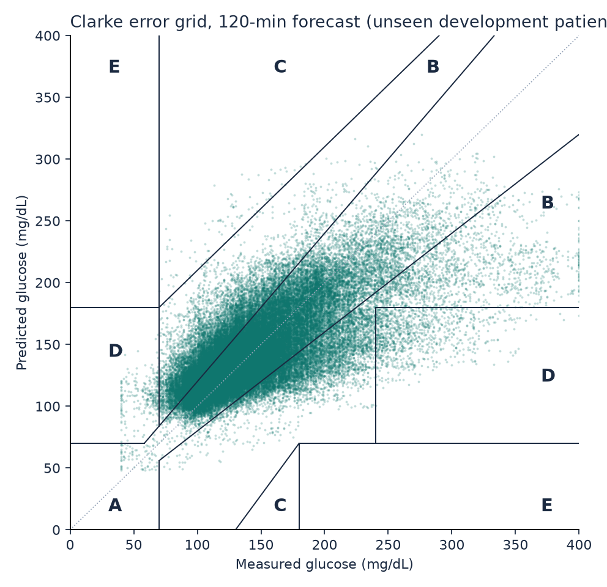
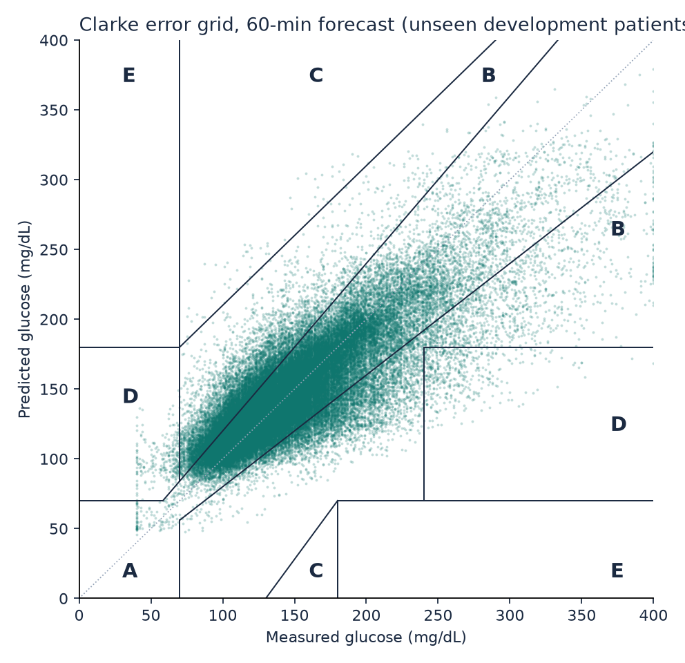
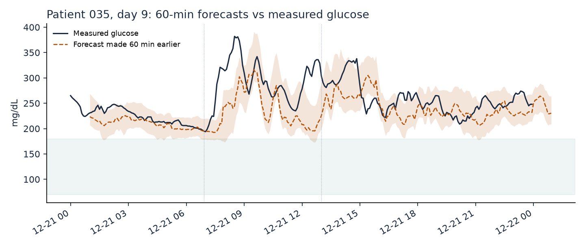
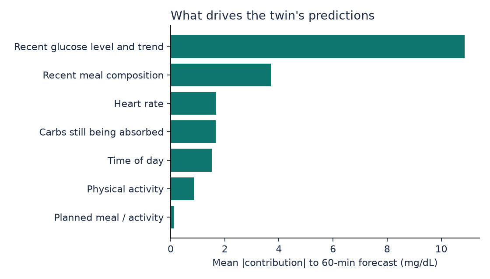
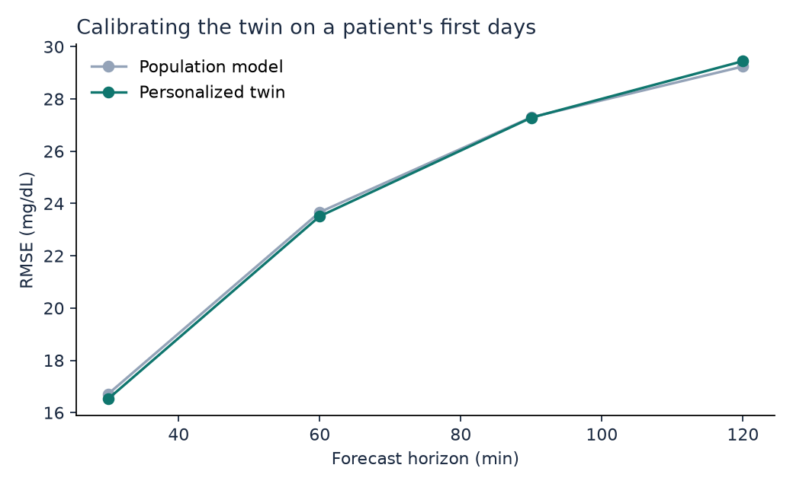
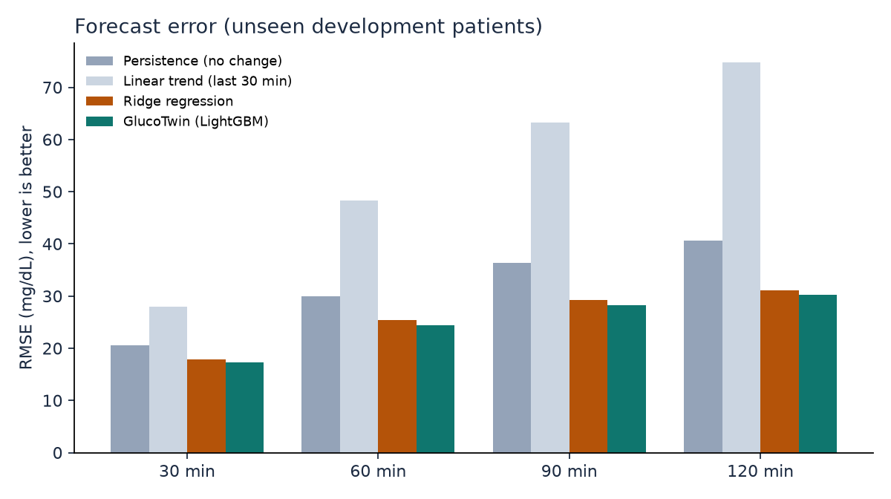
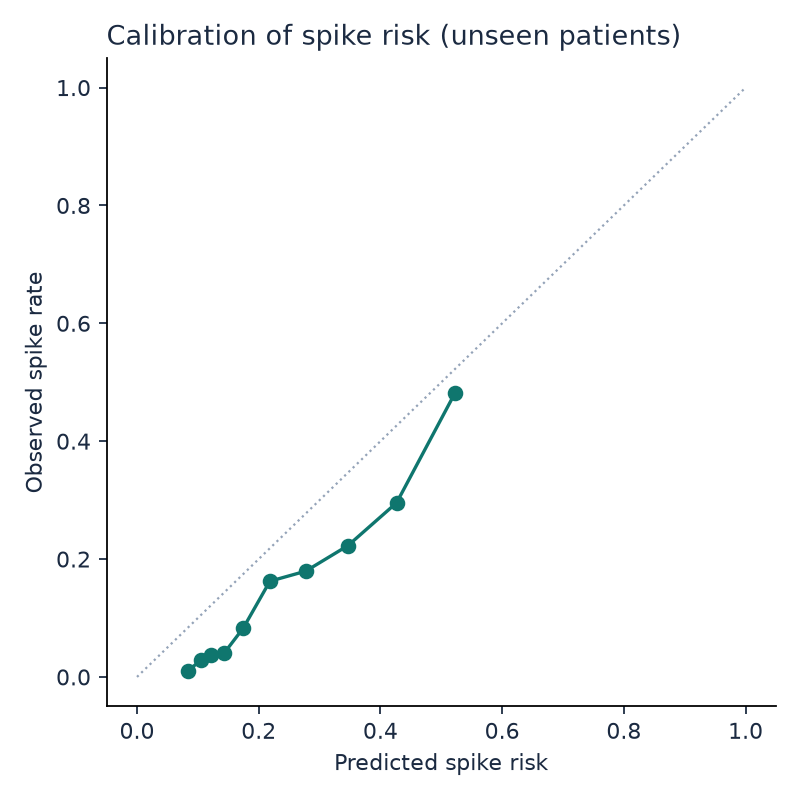

# GlucoTwin development results (cross-validation)

Leave-patients-out cross-validation over 36 development patients: each one is scored by a model that never saw them. Use these numbers to choose settings. The 9 locked test patients were not used; their results come from `python -m glucotwin.test` (artifacts/test/RESULTS_TEST.md).

## Glucose forecast error (RMSE, mg/dL; lower is better)

| Model | 30 min | 60 min | 90 min | 120 min |
|---|---|---|---|---|
| Persistence (no change) | 20.6 | 30.0 | 36.3 | 40.7 |
| Linear trend (last 30 min) | 28.0 | 48.3 | 63.3 | 74.7 |
| Ridge regression | 17.9 | 25.4 | 29.2 | 31.1 |
| **GlucoTwin (honest: future meals and activity unknown)** | **17.2** | **24.4** | **28.2** | **30.3** |
| GlucoTwin personalized (scored after the calibration days) | 16.5 | 23.5 | 27.3 | 29.4 |
| same rows, population model (for comparison) | 16.7 | 23.7 | 27.3 | 29.2 |
| Oracle: real future meals and activity given (what-if accuracy, not a forecast) | 17.1 | 24.3 | 27.9 | 29.5 |

## Clinical accuracy (Clarke error grid, honest mode)

| Horizon | MAE | MARD % | Zone A % | Zone A+B % | Zone D+E % | 80% band coverage % |
|---|---|---|---|---|---|---|
| 30 min | 11.4 | 8.0 | 91.7 | 99.6 | 0.37 | 81.8 |
| 60 min | 16.1 | 11.3 | 83.3 | 99.2 | 0.78 | 82.3 |
| 90 min | 18.7 | 13.0 | 78.5 | 98.8 | 1.13 | 82.4 |
| 120 min | 20.2 | 14.0 | 75.9 | 98.5 | 1.39 | 82.5 |

## R2: read this before quoting it

R2 on absolute glucose is inflated by autocorrelation: doing nothing (persistence) already scores high. R2 of the predicted *change* is the honest skill measure.

| Horizon | R2 absolute (GlucoTwin) | R2 absolute (persistence) | R2 of change (GlucoTwin) | Pearson r |
|---|---|---|---|---|
| 30 min | 0.844 | 0.777 | 0.298 | 0.919 |
| 60 min | 0.686 | 0.526 | 0.339 | 0.829 |
| 90 min | 0.581 | 0.306 | 0.396 | 0.763 |
| 120 min | 0.517 | 0.130 | 0.445 | 0.719 |

## By metabolic group

| Group | Patients | RMSE 30 min | RMSE 60 min | RMSE 90 min | RMSE 120 min | Spike AUROC |
|---|---|---|---|---|---|---|
| healthy | 12 | 14.9 | 19.2 | 21.3 | 22.2 | 0.834 |
| prediabetes | 13 | 16.8 | 23.0 | 25.7 | 27.4 | 0.771 |
| t2d | 11 | 19.9 | 30.3 | 36.4 | 39.6 | 0.711 |

## Adverse-event prediction: glucose excursion within 2 hours

- Rows evaluated: 85,388 (positive rate 15.4%)
- AUROC 0.793, AUPRC 0.406, Brier score 0.118 (accuracy is deliberately not reported: with 15% positives it rewards a model that never alerts)
- At the threshold chosen on development patients: precision 0.51, recall (sensitivity) 0.30, specificity 0.95, F1 0.38
- Event level: 614 crossings above 180 mg/dL; 60% caught in advance, median warning 100.0 min (longest measurable: 120 min), 1.39 false alerts per patient-day, alert active 15% of the time

## Figures

## Run time

- cross-validation: 188 s
- development model: 38 s
- total: 231 s
