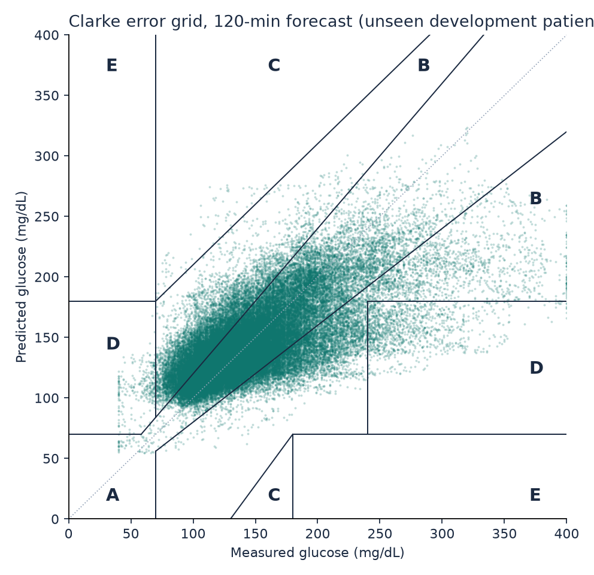
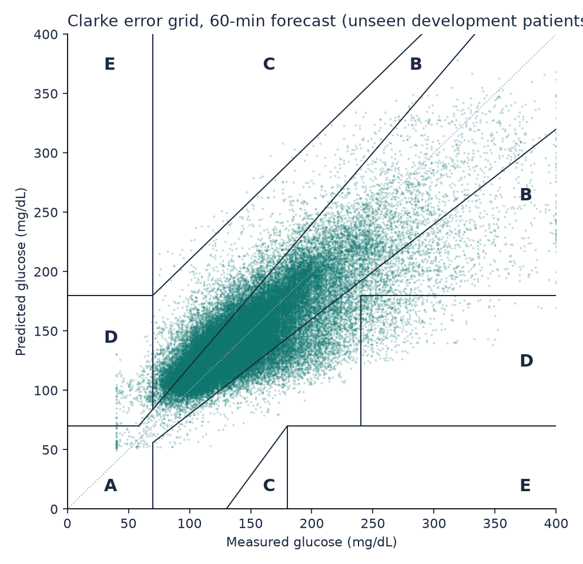
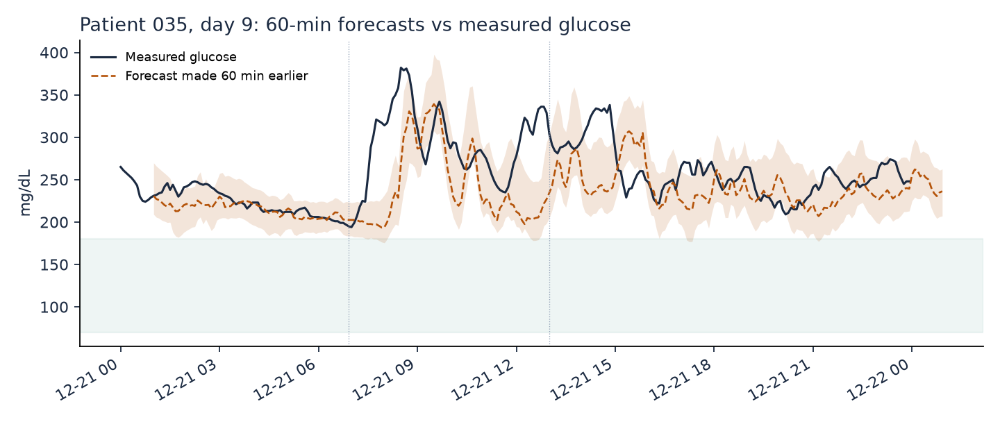
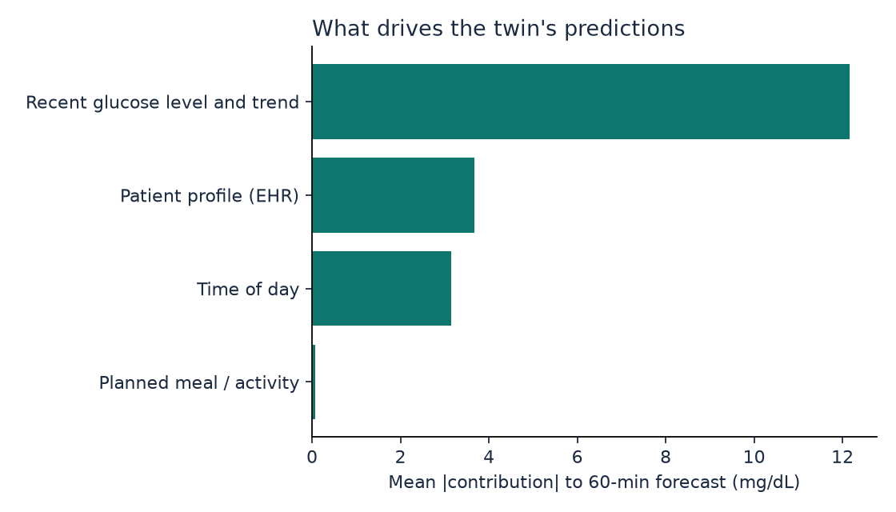
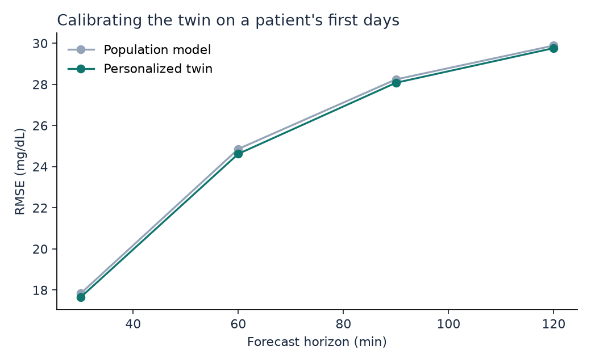
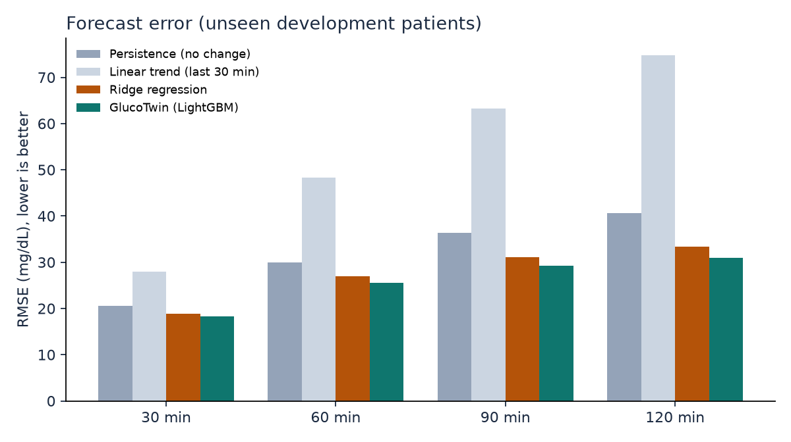
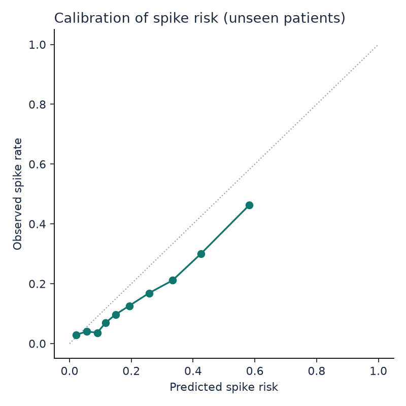

# GlucoTwin development results (cross-validation)

Leave-patients-out cross-validation over 36 development patients: each one is scored by a model that never saw them. Use these numbers to choose settings. The 9 locked test patients were not used; their results come from `python -m glucotwin.test` (artifacts/test/RESULTS_TEST.md).

## Glucose forecast error (RMSE, mg/dL; lower is better)

| Model | 30 min | 60 min | 90 min | 120 min |
|---|---|---|---|---|
| Persistence (no change) | 20.6 | 30.0 | 36.3 | 40.7 |
| Linear trend (last 30 min) | 28.0 | 48.3 | 63.3 | 74.7 |
| Ridge regression | 18.9 | 26.9 | 31.1 | 33.3 |
| **GlucoTwin (honest: future meals and activity unknown)** | **18.3** | **25.6** | **29.2** | **31.0** |
| GlucoTwin personalized (scored after the calibration days) | 17.6 | 24.6 | 28.1 | 29.8 |
| same rows, population model (for comparison) | 17.8 | 24.9 | 28.2 | 29.9 |
| Oracle: real future meals and activity given (what-if accuracy, not a forecast) | 18.2 | 25.6 | 29.0 | 30.1 |

## Clinical accuracy (Clarke error grid, honest mode)

| Horizon | MAE | MARD % | Zone A % | Zone A+B % | Zone D+E % | 80% band coverage % |
|---|---|---|---|---|---|---|
| 30 min | 12.1 | 8.6 | 90.6 | 99.6 | 0.45 | 81.3 |
| 60 min | 17.1 | 11.9 | 81.4 | 99.0 | 1.00 | 82.1 |
| 90 min | 19.6 | 13.7 | 76.9 | 98.6 | 1.35 | 82.7 |
| 120 min | 20.8 | 14.5 | 74.8 | 98.4 | 1.55 | 83.2 |

## R2: read this before quoting it

R2 on absolute glucose is inflated by autocorrelation: doing nothing (persistence) already scores high. R2 of the predicted *change* is the honest skill measure.

| Horizon | R2 absolute (GlucoTwin) | R2 absolute (persistence) | R2 of change (GlucoTwin) | Pearson r |
|---|---|---|---|---|
| 30 min | 0.823 | 0.777 | 0.207 | 0.908 |
| 60 min | 0.655 | 0.526 | 0.272 | 0.810 |
| 90 min | 0.551 | 0.306 | 0.353 | 0.743 |
| 120 min | 0.495 | 0.130 | 0.419 | 0.704 |

## By metabolic group

| Group | Patients | RMSE 30 min | RMSE 60 min | RMSE 90 min | RMSE 120 min | Spike AUROC |
|---|---|---|---|---|---|---|
| healthy | 12 | 15.8 | 19.7 | 21.4 | 22.2 | 0.730 |
| prediabetes | 13 | 18.1 | 24.6 | 27.0 | 28.0 | 0.731 |
| t2d | 11 | 20.9 | 31.7 | 37.7 | 40.9 | 0.724 |

## Adverse-event prediction: glucose excursion within 2 hours

- Rows evaluated: 85,388 (positive rate 15.4%)
- AUROC 0.770, AUPRC 0.384, Brier score 0.120 (accuracy is deliberately not reported: with 15% positives it rewards a model that never alerts)
- At the threshold chosen on development patients: precision 0.48, recall (sensitivity) 0.34, specificity 0.93, F1 0.40
- Event level: 614 crossings above 180 mg/dL; 65% caught in advance, median warning 115.0 min (longest measurable: 120 min), 1.49 false alerts per patient-day, alert active 19% of the time

## Figures

## Run time

- cross-validation: 131 s
- development model: 29 s
- total: 165 s
