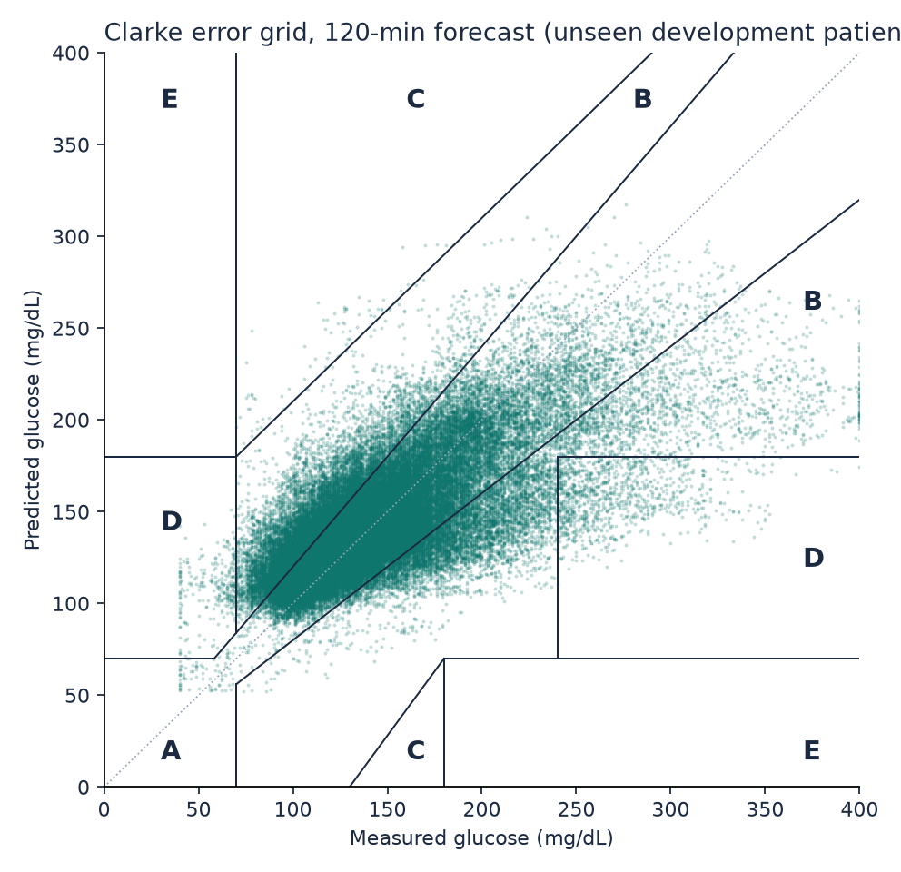
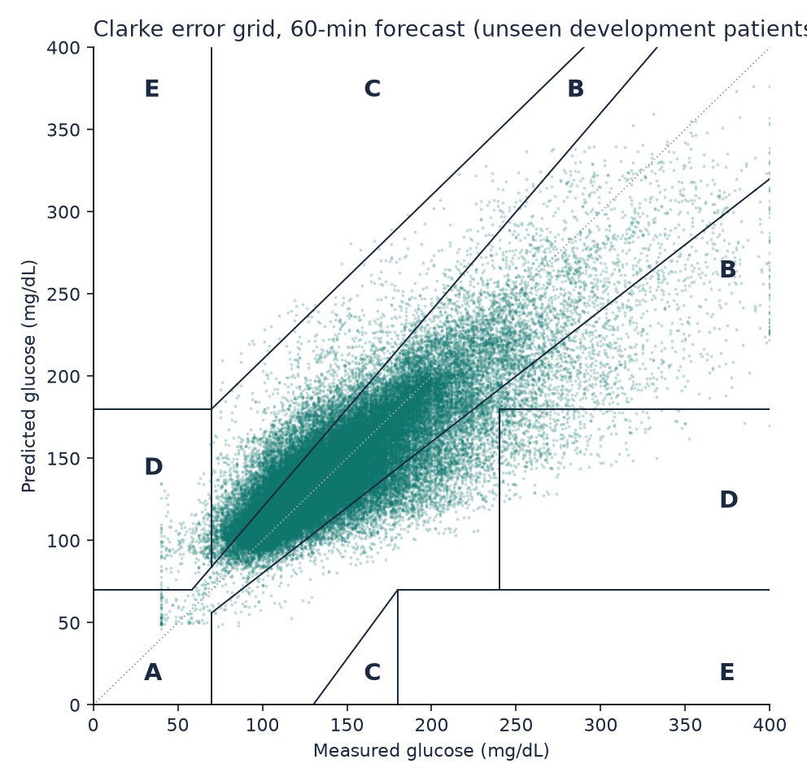
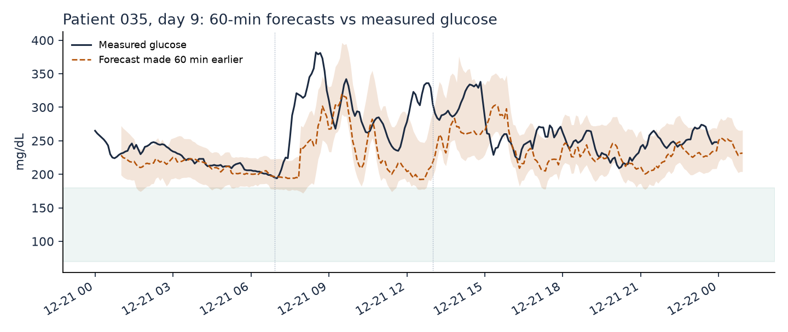
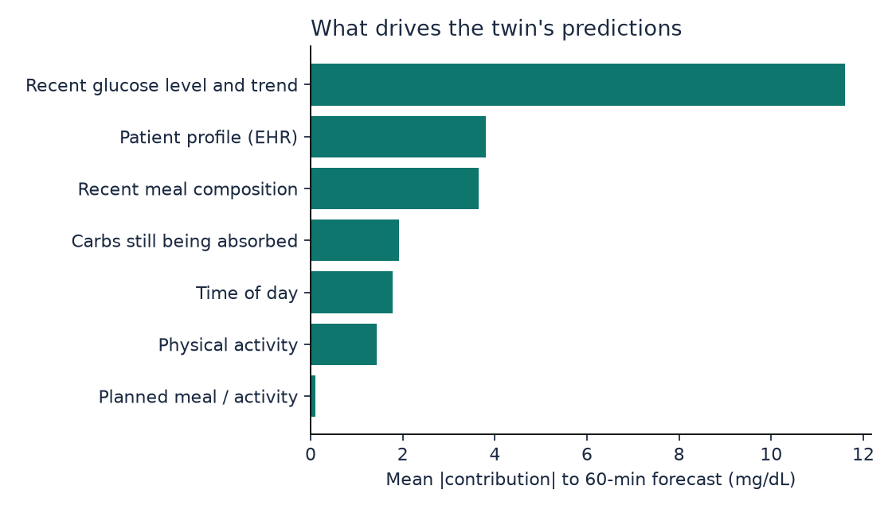
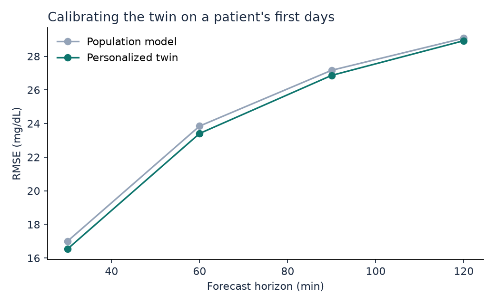
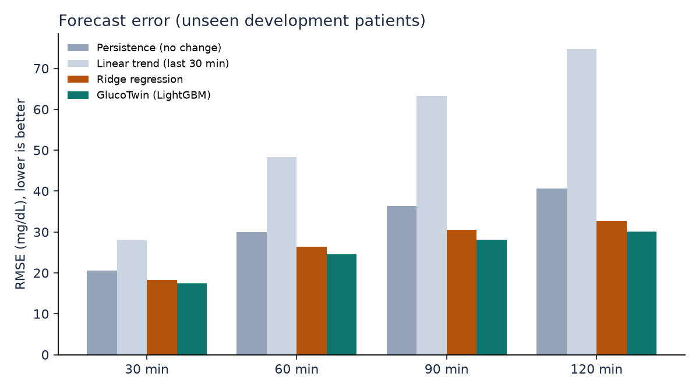
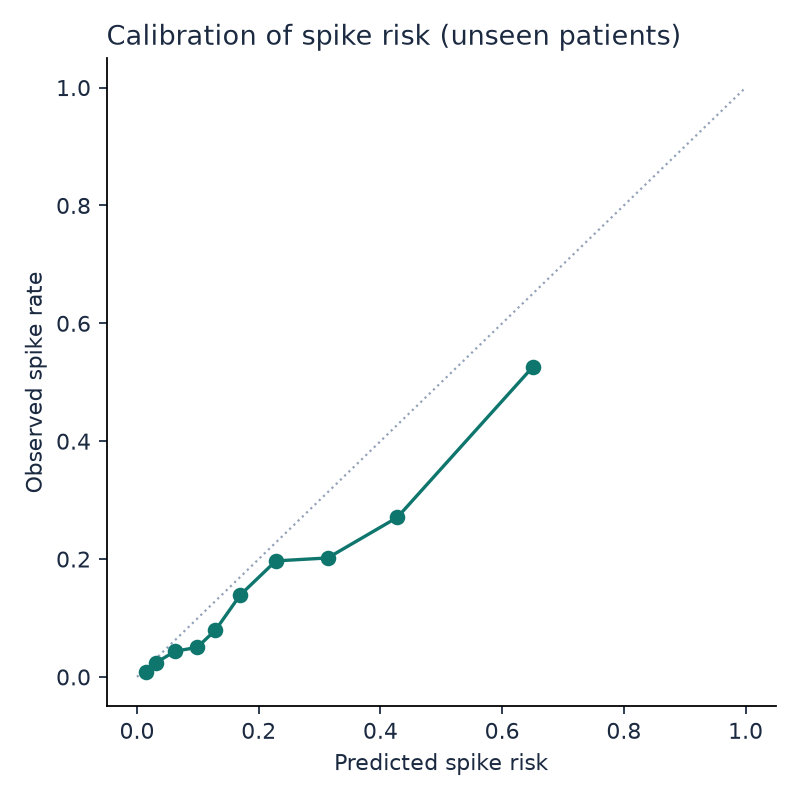

# GlucoTwin development results (cross-validation)

Leave-patients-out cross-validation over 36 development patients: each one is scored by a model that never saw them. Use these numbers to choose settings. The 9 locked test patients were not used; their results come from `python -m glucotwin.test` (artifacts/test/RESULTS_TEST.md).

## Glucose forecast error (RMSE, mg/dL; lower is better)

| Model | 30 min | 60 min | 90 min | 120 min |
|---|---|---|---|---|
| Persistence (no change) | 20.6 | 30.0 | 36.3 | 40.7 |
| Linear trend (last 30 min) | 28.0 | 48.3 | 63.3 | 74.7 |
| Ridge regression | 18.3 | 26.3 | 30.5 | 32.6 |
| **GlucoTwin (honest: future meals and activity unknown)** | **17.5** | **24.6** | **28.1** | **30.1** |
| GlucoTwin personalized (scored after the calibration days) | 16.5 | 23.4 | 26.9 | 28.9 |
| same rows, population model (for comparison) | 17.0 | 23.9 | 27.2 | 29.1 |
| Oracle: real future meals and activity given (what-if accuracy, not a forecast) | 17.4 | 24.4 | 27.7 | 29.2 |

## Clinical accuracy (Clarke error grid, honest mode)

| Horizon | MAE | MARD % | Zone A % | Zone A+B % | Zone D+E % | 80% band coverage % |
|---|---|---|---|---|---|---|
| 30 min | 11.5 | 8.1 | 91.5 | 99.6 | 0.40 | 81.8 |
| 60 min | 16.3 | 11.4 | 83.1 | 99.1 | 0.88 | 82.6 |
| 90 min | 18.7 | 13.0 | 78.4 | 98.8 | 1.16 | 83.0 |
| 120 min | 20.2 | 14.1 | 75.7 | 98.5 | 1.41 | 83.4 |

## R2: read this before quoting it

R2 on absolute glucose is inflated by autocorrelation: doing nothing (persistence) already scores high. R2 of the predicted *change* is the honest skill measure.

| Horizon | R2 absolute (GlucoTwin) | R2 absolute (persistence) | R2 of change (GlucoTwin) | Pearson r |
|---|---|---|---|---|
| 30 min | 0.839 | 0.777 | 0.276 | 0.917 |
| 60 min | 0.682 | 0.526 | 0.330 | 0.828 |
| 90 min | 0.586 | 0.306 | 0.403 | 0.767 |
| 120 min | 0.522 | 0.130 | 0.451 | 0.724 |

## By metabolic group

| Group | Patients | RMSE 30 min | RMSE 60 min | RMSE 90 min | RMSE 120 min | Spike AUROC |
|---|---|---|---|---|---|---|
| healthy | 12 | 14.9 | 18.9 | 20.7 | 21.6 | 0.803 |
| prediabetes | 13 | 17.2 | 23.5 | 26.1 | 27.3 | 0.754 |
| t2d | 11 | 20.3 | 30.5 | 36.1 | 39.6 | 0.750 |

## Adverse-event prediction: glucose excursion within 2 hours

- Rows evaluated: 85,388 (positive rate 15.4%)
- AUROC 0.800, AUPRC 0.457, Brier score 0.112 (accuracy is deliberately not reported: with 15% positives it rewards a model that never alerts)
- At the threshold chosen on development patients: precision 0.51, recall (sensitivity) 0.37, specificity 0.93, F1 0.43
- Event level: 614 crossings above 180 mg/dL; 67% caught in advance, median warning 117.5 min (longest measurable: 120 min), 1.54 false alerts per patient-day, alert active 20% of the time

## Figures

## Run time

- cross-validation: 204 s
- development model: 42 s
- total: 251 s
