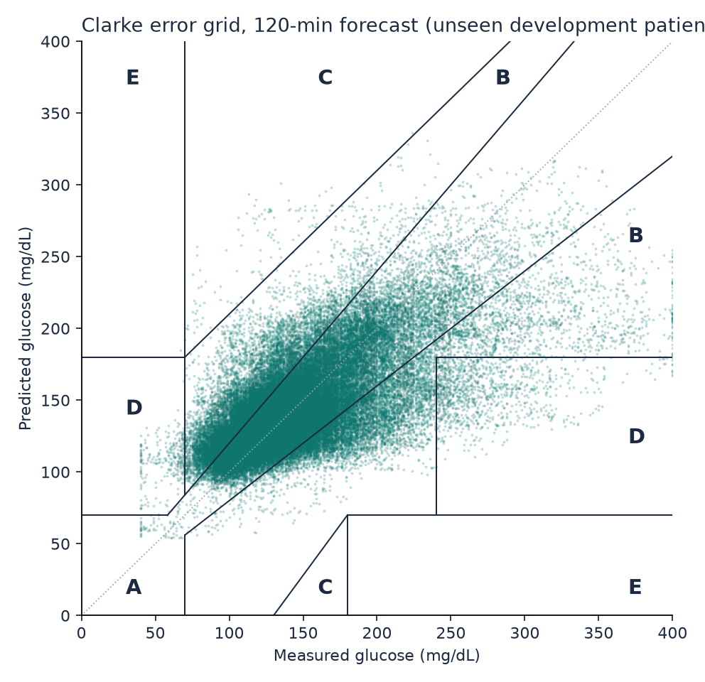
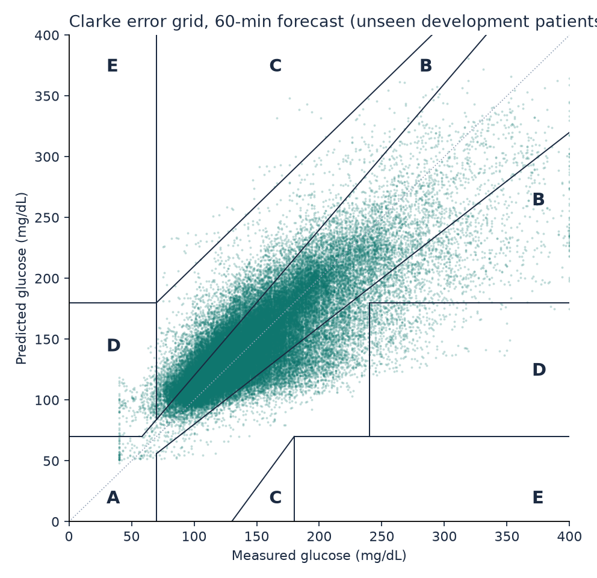
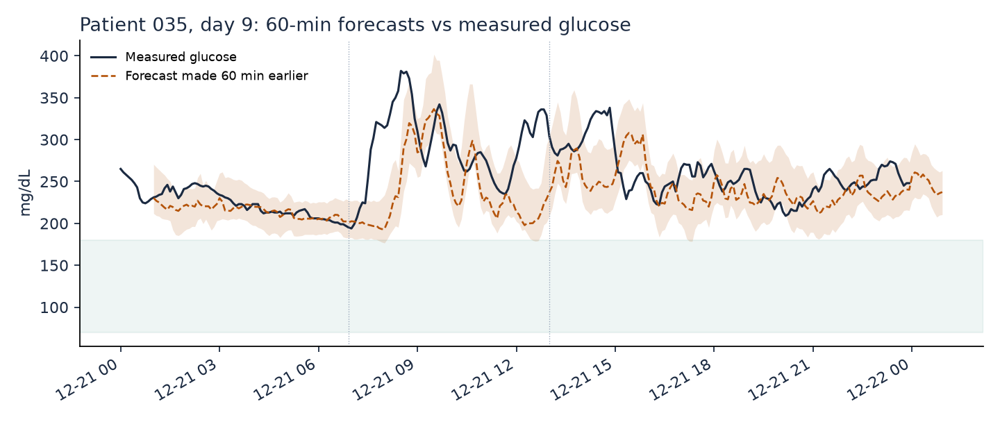
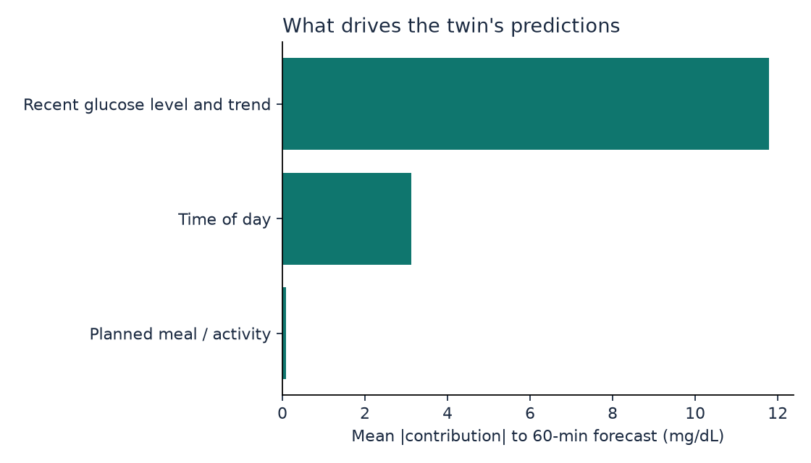
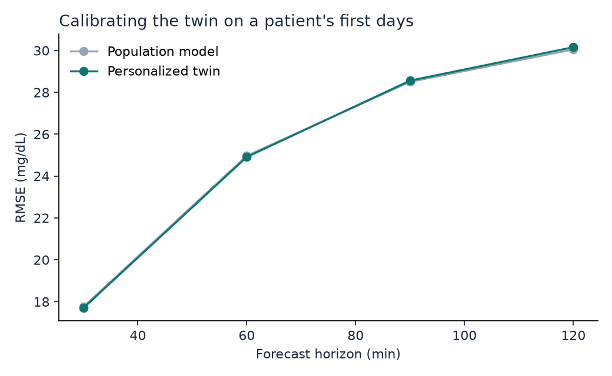
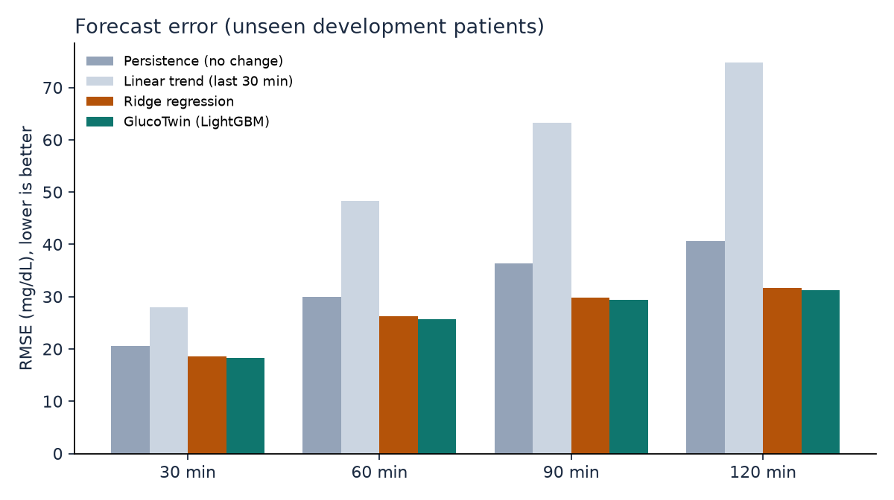
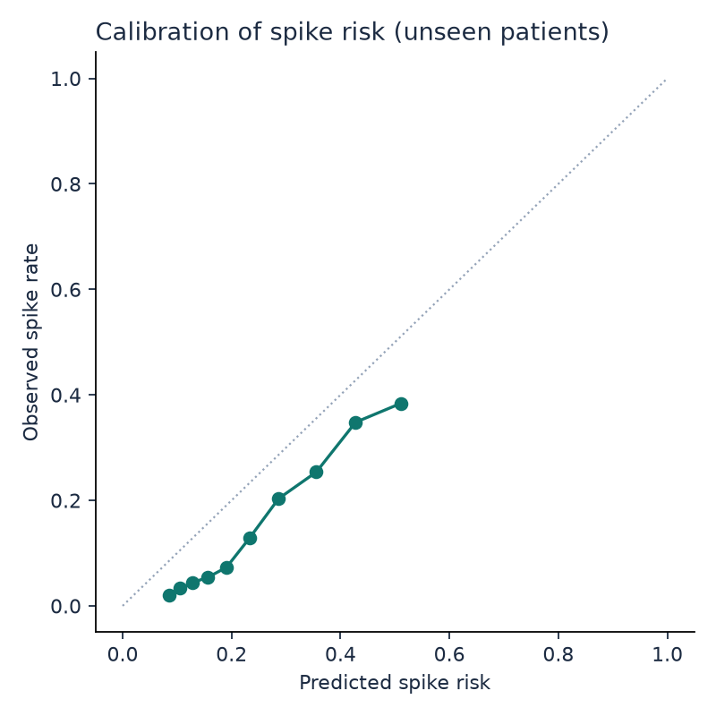

# GlucoTwin development results (cross-validation)

Leave-patients-out cross-validation over 36 development patients: each one is scored by a model that never saw them. Use these numbers to choose settings. The 9 locked test patients were not used; their results come from `python -m glucotwin.test` (artifacts/test/RESULTS_TEST.md).

## Glucose forecast error (RMSE, mg/dL; lower is better)

| Model | 30 min | 60 min | 90 min | 120 min |
|---|---|---|---|---|
| Persistence (no change) | 20.6 | 30.0 | 36.3 | 40.7 |
| Linear trend (last 30 min) | 28.0 | 48.3 | 63.3 | 74.7 |
| Ridge regression | 18.6 | 26.2 | 29.9 | 31.7 |
| **GlucoTwin (honest: future meals and activity unknown)** | **18.3** | **25.7** | **29.4** | **31.2** |
| GlucoTwin personalized (scored after the calibration days) | 17.7 | 24.9 | 28.6 | 30.2 |
| same rows, population model (for comparison) | 17.8 | 25.0 | 28.5 | 30.0 |
| Oracle: real future meals and activity given (what-if accuracy, not a forecast) | 18.2 | 25.7 | 29.3 | 30.4 |

## Clinical accuracy (Clarke error grid, honest mode)

| Horizon | MAE | MARD % | Zone A % | Zone A+B % | Zone D+E % | 80% band coverage % |
|---|---|---|---|---|---|---|
| 30 min | 12.1 | 8.6 | 90.5 | 99.6 | 0.43 | 81.5 |
| 60 min | 17.1 | 11.9 | 81.6 | 99.0 | 0.90 | 82.0 |
| 90 min | 19.5 | 13.5 | 77.2 | 98.6 | 1.29 | 82.1 |
| 120 min | 20.8 | 14.4 | 75.0 | 98.4 | 1.46 | 82.4 |

## R2: read this before quoting it

R2 on absolute glucose is inflated by autocorrelation: doing nothing (persistence) already scores high. R2 of the predicted *change* is the honest skill measure.

| Horizon | R2 absolute (GlucoTwin) | R2 absolute (persistence) | R2 of change (GlucoTwin) | Pearson r |
|---|---|---|---|---|
| 30 min | 0.824 | 0.777 | 0.211 | 0.908 |
| 60 min | 0.652 | 0.526 | 0.267 | 0.808 |
| 90 min | 0.544 | 0.306 | 0.342 | 0.737 |
| 120 min | 0.487 | 0.130 | 0.410 | 0.698 |

## By metabolic group

| Group | Patients | RMSE 30 min | RMSE 60 min | RMSE 90 min | RMSE 120 min | Spike AUROC |
|---|---|---|---|---|---|---|
| healthy | 12 | 15.8 | 19.9 | 21.7 | 22.4 | 0.798 |
| prediabetes | 13 | 17.9 | 24.3 | 26.9 | 28.2 | 0.762 |
| t2d | 11 | 21.0 | 32.1 | 38.1 | 41.1 | 0.679 |

## Adverse-event prediction: glucose excursion within 2 hours

- Rows evaluated: 85,388 (positive rate 15.4%)
- AUROC 0.774, AUPRC 0.363, Brier score 0.122 (accuracy is deliberately not reported: with 15% positives it rewards a model that never alerts)
- At the threshold chosen on development patients: precision 0.48, recall (sensitivity) 0.35, specificity 0.93, F1 0.40
- Event level: 614 crossings above 180 mg/dL; 62% caught in advance, median warning 120.0 min (longest measurable: 120 min), 1.45 false alerts per patient-day, alert active 19% of the time

## Figures

## Run time

- cross-validation: 117 s
- development model: 26 s
- total: 147 s
