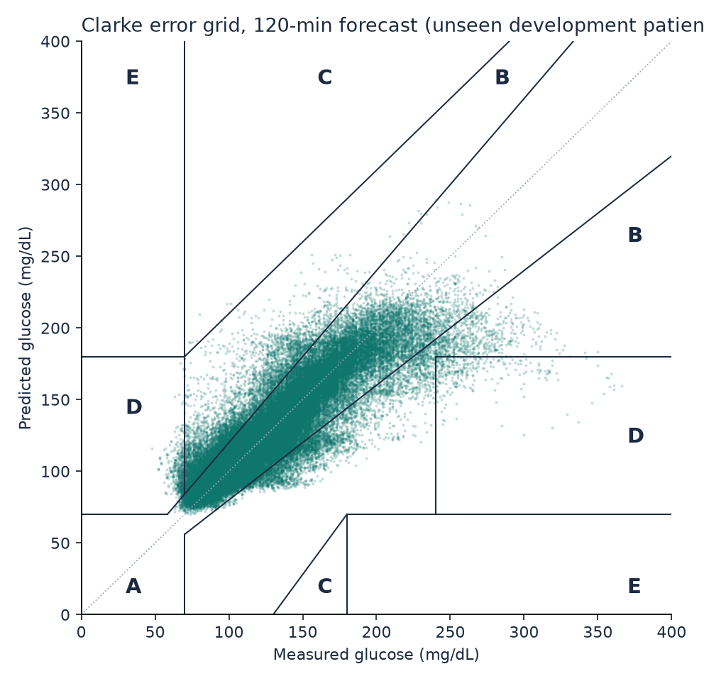
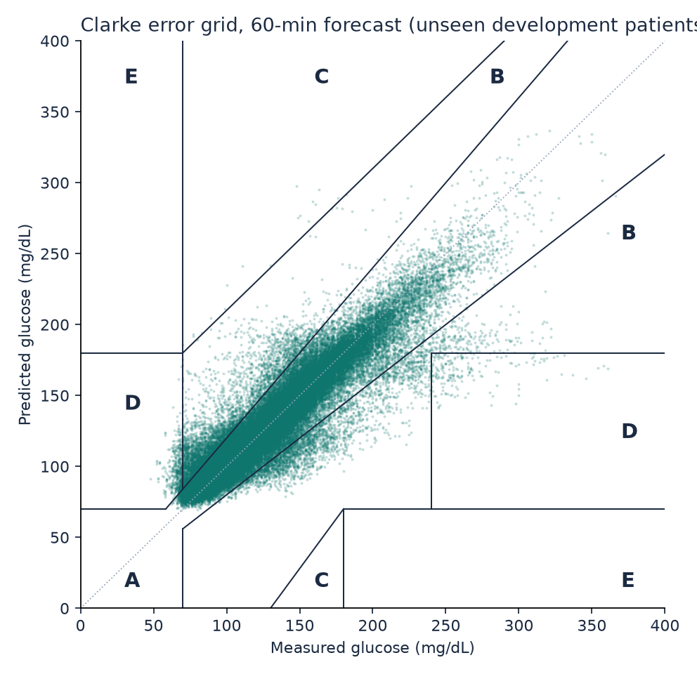
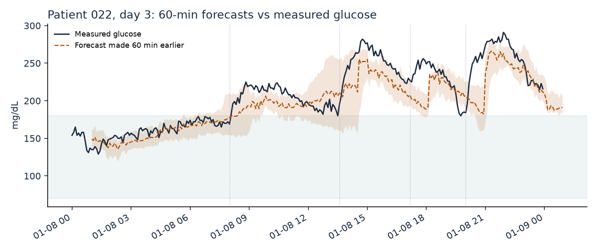
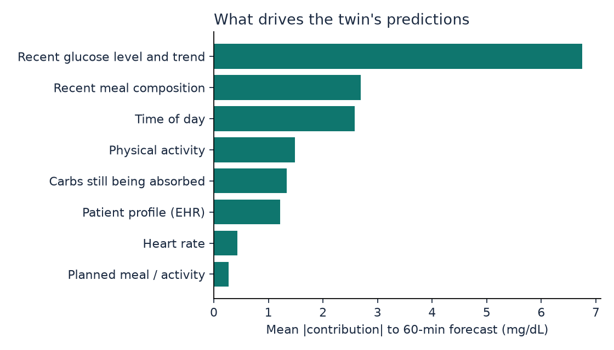
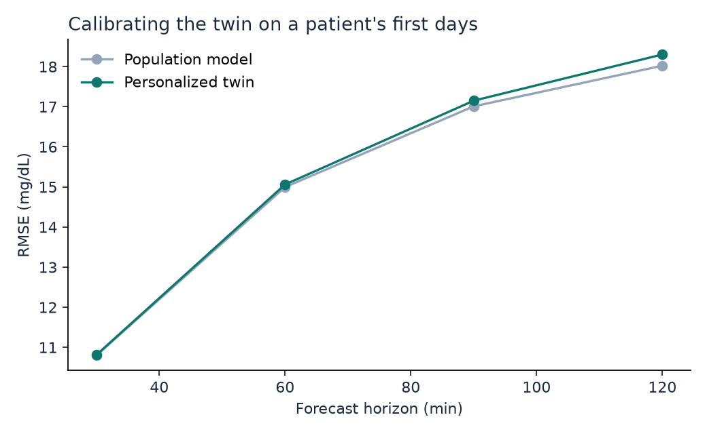
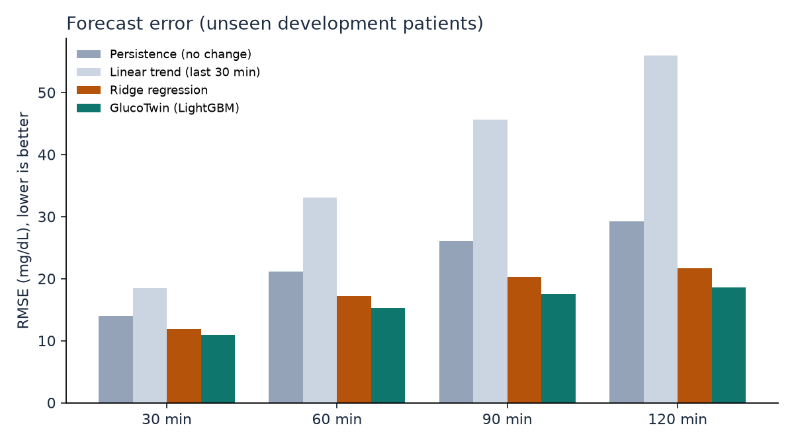
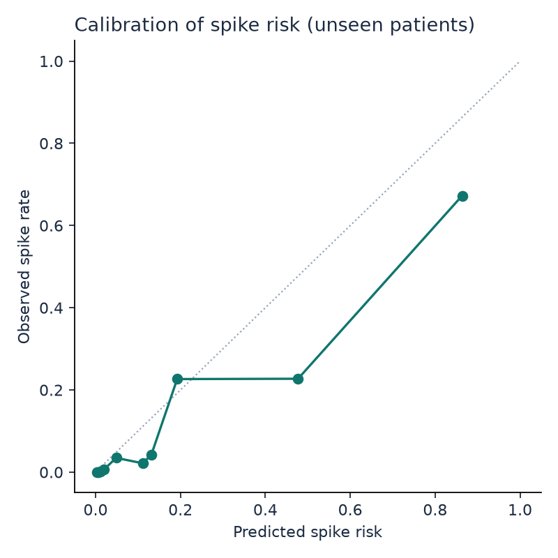

# GlucoTwin development results (cross-validation)

Leave-patients-out cross-validation over 36 development patients: each one is scored by a model that never saw them. Use these numbers to choose settings. The 9 locked test patients were not used; their results come from `python -m glucotwin.test` (artifacts/test/RESULTS_TEST.md).

## Glucose forecast error (RMSE, mg/dL; lower is better)

| Model | 30 min | 60 min | 90 min | 120 min |
|---|---|---|---|---|
| Persistence (no change) | 14.0 | 21.1 | 26.0 | 29.3 |
| Linear trend (last 30 min) | 18.5 | 33.1 | 45.7 | 55.9 |
| Ridge regression | 11.9 | 17.2 | 20.3 | 21.7 |
| **GlucoTwin (honest: future meals and activity unknown)** | **10.9** | **15.3** | **17.5** | **18.5** |
| GlucoTwin personalized (scored after the calibration days) | 10.8 | 15.1 | 17.2 | 18.3 |
| same rows, population model (for comparison) | 10.8 | 15.0 | 17.0 | 18.0 |
| Oracle: real future meals and activity given (what-if accuracy, not a forecast) | 10.1 | 13.8 | 15.9 | 15.4 |

## Clinical accuracy (Clarke error grid, honest mode)

| Horizon | MAE | MARD % | Zone A % | Zone A+B % | Zone D+E % | 80% band coverage % |
|---|---|---|---|---|---|---|
| 30 min | 7.2 | 6.0 | 96.3 | 99.6 | 0.44 | 80.0 |
| 60 min | 9.8 | 8.1 | 92.0 | 99.2 | 0.81 | 80.0 |
| 90 min | 11.4 | 9.3 | 89.3 | 99.0 | 0.96 | 79.6 |
| 120 min | 12.3 | 9.9 | 87.8 | 99.0 | 1.02 | 79.0 |

## R2: read this before quoting it

R2 on absolute glucose is inflated by autocorrelation: doing nothing (persistence) already scores high. R2 of the predicted *change* is the honest skill measure.

| Horizon | R2 absolute (GlucoTwin) | R2 absolute (persistence) | R2 of change (GlucoTwin) | Pearson r |
|---|---|---|---|---|
| 30 min | 0.917 | 0.863 | 0.396 | 0.958 |
| 60 min | 0.837 | 0.688 | 0.475 | 0.915 |
| 90 min | 0.787 | 0.527 | 0.550 | 0.887 |
| 120 min | 0.761 | 0.403 | 0.599 | 0.872 |

## By metabolic group

| Group | Patients | RMSE 30 min | RMSE 60 min | RMSE 90 min | RMSE 120 min | Spike AUROC |
|---|---|---|---|---|---|---|
| healthy | 12 | 8.7 | 11.4 | 12.5 | 12.8 | 0.821 |
| prediabetes | 13 | 9.6 | 13.3 | 14.8 | 15.4 | 0.895 |
| t2d | 11 | 14.1 | 20.5 | 23.9 | 25.8 | 0.887 |

## Adverse-event prediction: glucose excursion within 2 hours

- Rows evaluated: 91,762 (positive rate 12.3%)
- AUROC 0.918, AUPRC 0.664, Brier score 0.077 (accuracy is deliberately not reported: with 12% positives it rewards a model that never alerts)
- At the threshold chosen on development patients: precision 0.52, recall (sensitivity) 0.78, specificity 0.90, F1 0.63
- Event level: 340 crossings above 180 mg/dL; 99% caught in advance, median warning 120.0 min (longest measurable: 120 min), 2.36 false alerts per patient-day, alert active 25% of the time

## Figures

## Run time

- cross-validation: 230 s
- development model: 45 s
- total: 279 s
