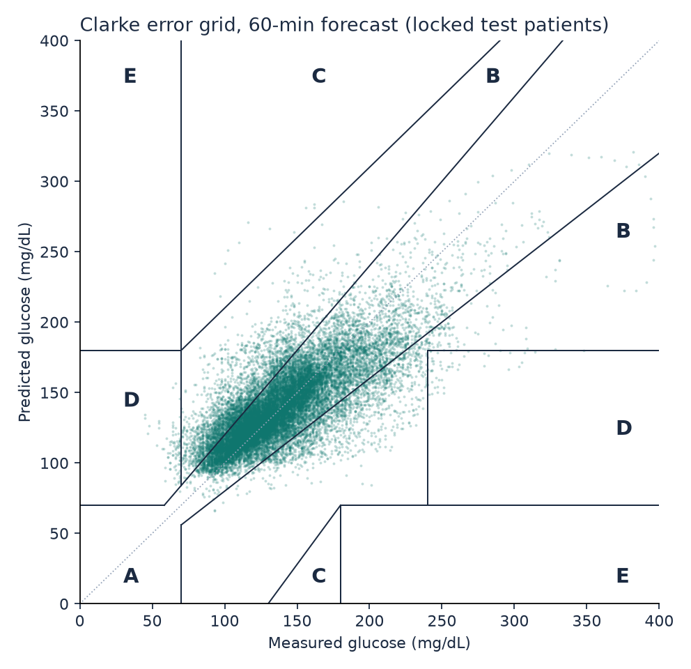
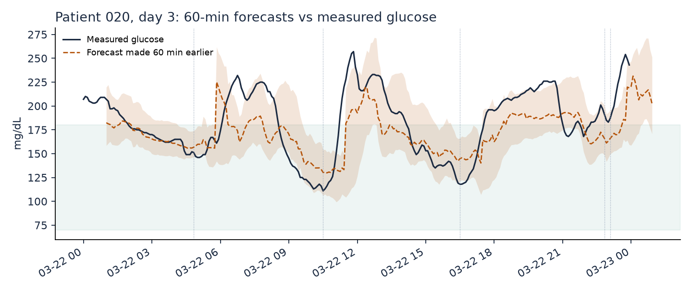
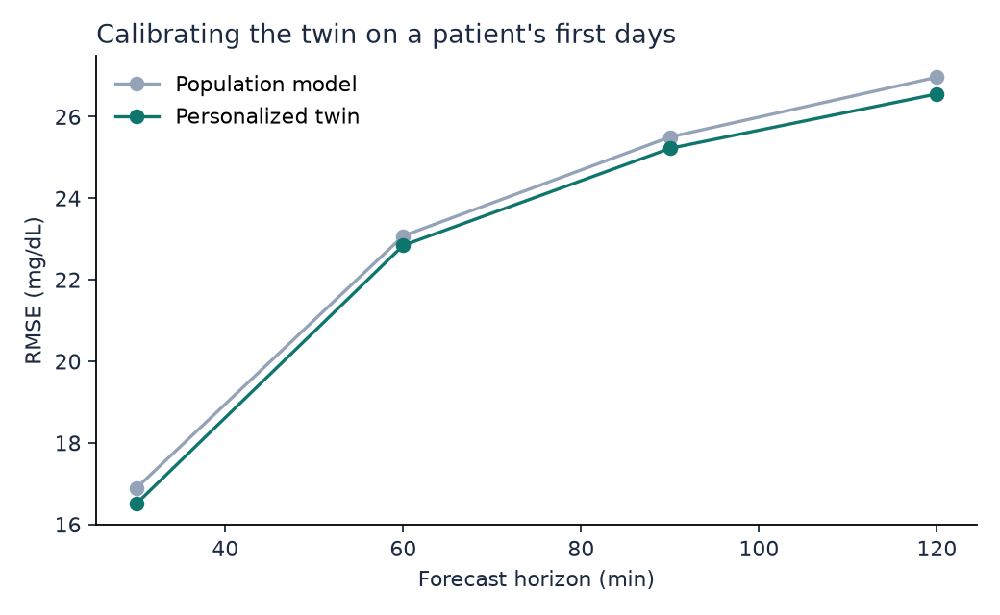
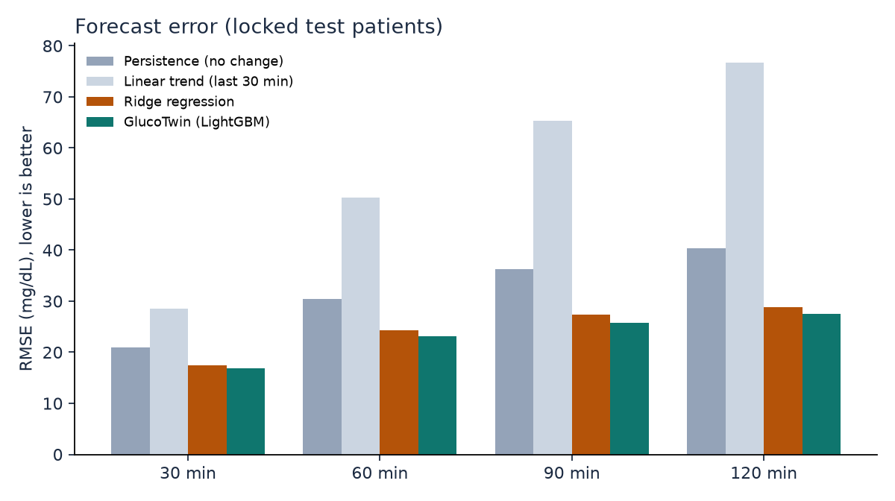
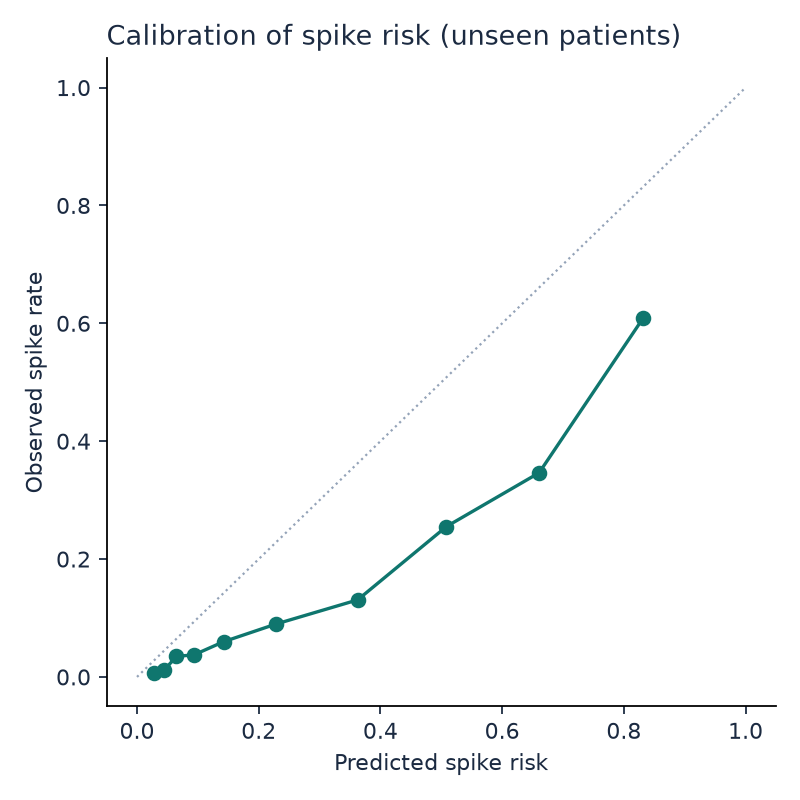

# GlucoTwin results on the locked test patients

9 patients (002, 004, 013, 014, 020, 032, 042, 044, 049) were set aside before any training or tuning, stratified by metabolic group. Every model, threshold and weight below was chosen on the development patients only. These are the numbers to report. With so few test patients the intervals are wide; quote them.

## Glucose forecast error (RMSE, mg/dL; lower is better)

| Model | 30 min | 60 min | 90 min | 120 min |
|---|---|---|---|---|
| Persistence (no change) | 20.9 | 30.5 | 36.3 | 40.3 |
| Linear trend (last 30 min) | 28.5 | 50.3 | 65.4 | 76.6 |
| Ridge regression | 17.4 | 24.3 | 27.4 | 28.8 |
| **GlucoTwin (honest: future meals and activity unknown)** | **16.9** (14.9 to 18.6) | **23.1** (20.2 to 26.0) | **25.7** (21.5 to 29.9) | **27.4** (22.5 to 32.2) |
| GlucoTwin personalized (scored after the calibration days) | 16.5 | 22.8 | 25.2 | 26.6 |
| same rows, population model (for comparison) | 16.9 | 23.1 | 25.5 | 27.0 |
| Oracle: real future meals and activity given (what-if accuracy, not a forecast) | 16.7 | 22.9 | 25.5 | 26.7 |

Brackets: 95% confidence interval from resampling patients (bootstrap).

## Clinical accuracy (Clarke error grid, honest mode)

| Horizon | MAE | MARD % | Zone A % | Zone A+B % | Zone D+E % | 80% band coverage % |
|---|---|---|---|---|---|---|
| 30 min | 11.5 | 8.5 | 90.8 | 99.7 | 0.34 | 79.8 |
| 60 min | 16.2 | 12.0 | 81.7 | 99.4 | 0.53 | 78.9 |
| 90 min | 18.3 | 13.5 | 76.7 | 99.2 | 0.72 | 78.5 |
| 120 min | 19.7 | 14.4 | 73.8 | 98.9 | 0.99 | 79.4 |

## R2: read this before quoting it

R2 on absolute glucose is inflated by autocorrelation: doing nothing (persistence) already scores high. R2 of the predicted *change* is the honest skill measure.

| Horizon | R2 absolute (GlucoTwin) | R2 absolute (persistence) | R2 of change (GlucoTwin) | Pearson r |
|---|---|---|---|---|
| 30 min | 0.769 | 0.648 | 0.345 | 0.877 |
| 60 min | 0.570 | 0.251 | 0.426 | 0.756 |
| 90 min | 0.465 | -0.064 | 0.498 | 0.683 |
| 120 min | 0.393 | -0.309 | 0.536 | 0.629 |

## By metabolic group

| Group | Patients | RMSE 30 min | RMSE 60 min | RMSE 90 min | RMSE 120 min | Spike AUROC |
|---|---|---|---|---|---|---|
| healthy | 3 | 15.2 | 18.1 | 19.2 | 19.9 | 0.787 |
| prediabetes | 3 | 17.1 | 22.4 | 24.0 | 25.5 | 0.830 |
| t2d | 3 | 18.2 | 27.7 | 32.2 | 34.7 | 0.801 |

## Adverse-event prediction: glucose excursion within 2 hours

- Rows evaluated: 22,262 (positive rate 15.8%)
- AUROC 0.850 (95% CI 0.803 to 0.894), AUPRC 0.550, Brier score 0.128 (accuracy is deliberately not reported: with 16% positives it rewards a model that never alerts)
- At the threshold chosen on development patients: precision 0.45, recall (sensitivity) 0.67, specificity 0.84, F1 0.54
- Event level: 160 crossings above 180 mg/dL; 96% caught in advance, median warning 120.0 min (longest measurable: 120 min), 2.66 false alerts per patient-day, alert active 32% of the time

## Figures

# Neural model and ensemble on the locked test patients

Ensemble weights were fixed on development patients before this test.

RMSE in mg/dL (lower is better):

| Model | 30 min | 60 min | 90 min | 120 min |
|---|---|---|---|---|
| Ensemble | 16.9 | 23.0 | 25.8 | 27.4 |
| LightGBM | 16.9 | 23.1 | 25.7 | 27.4 |
| P-MRGF (neural) | 18.0 | 25.5 | 28.8 | 30.1 |

Spike AUROC: LightGBM 0.850, P-MRGF (neural) 0.794, Ensemble 0.848
